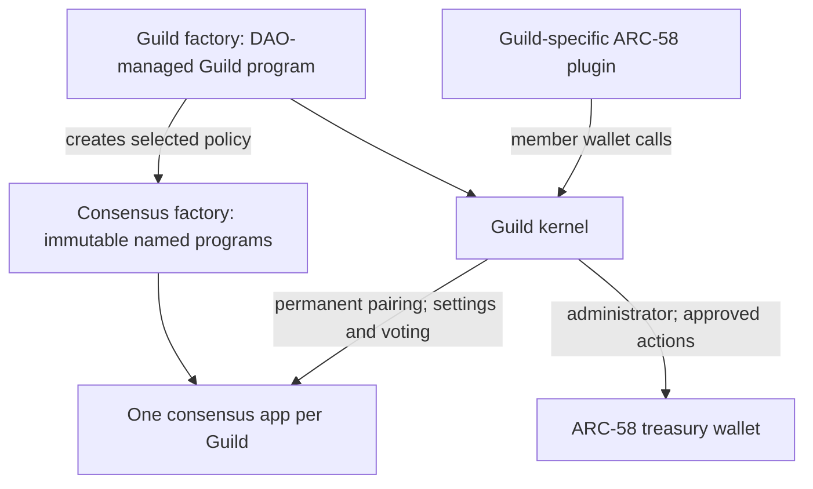

# Guild architecture

## Responsibilities and trust boundaries

The Guild factory creates only Guild kernels. The consensus factory creates
only consensus applications. Their creator addresses therefore establish
separate provenance without keeping a registry entry for every Guild. Anyone
may register a previously unused consensus name; names are immutable, and a name
alone is not an endorsement. The deployment script registers the three official
programs before publishing the factory IDs.
Both factories retain the shared Akita DAO upgrade authority. Registration
immutability describes the current API; reviewing a factory upgrade remains
part of the trust model.

A Guild stores its consensus address at creation. The selected policy is bound
once to that Guild in the same atomic deployment. Consensus mutations require
an inner call from its bound Guild. Consensus does not administer the treasury
or take custody of voting assets.

The Guild owns proposal storage, lifecycle, action dispatch, and wallet
administration. It asks consensus to validate every proposal-settings update,
including creation, direct draft configuration, plugin policy, and governed
changes. Consensus also checks the Guild settings at activation. Policy rules
belong to consensus rather than the Guild kernel.

## Consensus policies

- **Fixed signers:** equal or assigned weights, an absolute approval threshold,
  and optional participation and approval ratios, with at most 256 members.
  Every ballot freezes the membership epoch, weight mode, eligible total, and
  requirements. Membership
  additions, removals, and reweights can execute while other ballots remain
  open. Existing ballots retain their original voters and weights; new ballots
  use the new configuration. Active changes must preserve attainable Guild
  proposal requirements. A permanently locked membership cannot change.
- **Locked token:** reads universal staking, uses time-decayed locked power,
  requires at least one week of remaining lock time, and requires the lock to
  outlive the ballot. Power is measured in whole-token-years: the policy reads
  the asset's decimals at configuration, so one whole token locked for a year
  is one unit of power for any asset. Participation must be zero because a live
  locked-token total is not an enumerable snapshot of eligible decayed voting
  power. Minimum approvals and an approval ratio remain available. This policy
  reads a voter's lock when proposing/voting; it does not provide historical
  stake snapshots. Every proposal duration must be shorter than the longest
  lock universal staking accepts for the voting asset (one year unless the
  asset's creator configured another maximum), and activation requires that
  maximum to exceed one week. A locked-token Guild therefore trusts the voting
  asset's creator not to shorten the maximum lock afterwards; universal staking
  is expected to make that setting non-decreasing.
- **Subscription:** the policy application creates and owns every service that
  grants voting weight, so no outside service owner can pause, gate, or block
  the electorate. Services are ALGO-priced, ungated, share no passes, and pay
  out to the Guild application (`sweep()` forwards that revenue to the
  treasury). Governance adds services, reweights them, or removes them (which
  shuts the service down); the last offering can never be removed, and at most
  64 offerings are live at once. A subscription grants power only while it is
  paid up (`lastPayment + interval >= now`) at the moment its holder proposes
  or votes, so no ballot length can outlast every payment interval. Required
  proposer power can never exceed the largest live offering weight: activation
  checks it, and reweighting or removing an offering re-checks the Guild
  settings. Offering
  weights are versioned by epoch and every ballot freezes the epoch it opened
  at, so offering changes may execute while ballots are open. A subscriber whose
  offering changed after a ballot opened supplies `(subscriptionID, since)` as
  evidence; `SubscriptionGuildConsensusSDK.voteEvidence()` finds it. Participation
  must be zero because the subscription service does not expose an enumerable
  eligible total.

The locked-token and subscription approval floors can only be raised to the
approvals of the proposal that raises them, so a Guild can never set a floor its
own voters have not just demonstrated they can clear. The same rule applies to
every policy's per-class and per-code `minimumApprovals`: a voted
`SetProposalSettings` or `SetConsensusActionSettings` may keep or lower a
minimum, but may raise it only up to the approvals its own ballot recorded.

Changing settings needs the stronger class. `SetProposalSettings`,
`SetConsensusActionSettings`, and `SetPluginSettings` are governed by the
field-by-field strictest of their own class (updateGuild, or addPlugin for
plugin settings) and the settings they replace, so a weaker class can never
rewrite the rules of a stronger one.

Fixed-signer member boxes cost 25,300 microAlgos. Slot storage costs 3,200 per
allocated member slot plus a 2,900 base box cost. Additions quote the maximum
slot growth and refund unused space when a freed slot is reused. Removing or
reweighting a member funds a 25,300 historical checkpoint. Removal releases the
current member box back to the Guild, offsetting the history cost. Historical
records are retained; there is currently no history-pruning operation.
The attainability check covers the Guild's built-in proposal settings. Custom
plugin policies are stored separately; review their minimum approvals when
reducing membership or weights, and update them with a `SetPluginSettings`
proposal (action 22, addPlugin settings class). That action works even after
the plugin set is locked.

A fixed-signer ballot costs 45,000 microAlgos, including its 9,700 snapshot; a
subscription ballot costs 44,600, including its 9,300 snapshot; locked-token
ballots cost 35,300. Subscription offerings cost 12,500 plus a 3,200 weight slot and the
subscriptions app's service-creation cost (the first offering also funds the
2,900 slot box; a freed slot is reused and its quote refunded); reweighting funds a 15,700 history checkpoint and
removal funds the 3,200 difference after releasing the offering box. Each vote receipt costs 22,500. Cleanup refunds the
ballot and receipts exactly once. For an old ballot, a removed or reweighted
member supplies the eight-byte start epoch of the relevant historical record.
`FixedSignerGuildConsensusSDK.voteEvidence()` finds that record.

## Proposal and execution lifecycle

1. Create or edit a proposal, validating actions and proposer eligibility.
2. Submit it, funding a consensus ballot and freezing the requirements.
3. Vote through the Guild, forwarding the authenticated voter, evidence, and
   receipt payment. Consensus prevents duplicate votes.
4. Finalize after voting closes, resolving approval and participation rules.
5. Execute approved actions atomically. Failed execution leaves the proposal
   retryable. A voted proposal may spend only its own execution reserve.
   Execution re-checks each action but not the proposal action limit, so a later
   limit change never strands an approved proposal.
6. Cleanup releases consensus storage once a proposal is rejected, executed, or
   cancelled. Approved ballots stay until then because policies read the
   approving ballot while applying consensus actions.

Bootstrap proposals are approved on creation and only their creator may execute
them, and only while the Guild is in draft.

Refunds (draft prepayments, unused execution reserves, vote receipts, ballot
storage, and execution-key storage) go back to whoever paid them. If that
account has since closed and the refund is too small to re-open it, the refund
goes to the treasury instead, so a closed account can never block finalization,
cleanup, execution, or a committed self-upgrade. Storage released by removing a
plugin's execution policy also goes to the treasury, since it was funded by the
proposal that installed the plugin.

Approved proposals never expire. If one can no longer execute, its proposer may
`cancelProposal()` it: the status becomes Invalid (10), the execution reserve is
refunded, and cleanup becomes available.

## Treasury wallet

Like the Akita DAO, a Guild never adopts an existing wallet. The Guild factory
reads the wallet factory from the DAO's app list at mint time, and the Guild
creates its treasury through that factory, either with `setup()` during draft or
with a governed `NewWallet` proposal (action 82) whose proposer prepays the
wallet's creation cost. A fresh wallet has no domain keys, revocation app,
plugins, or execution keys from a previous owner. After `ChangeAdmin` hands the
treasury away, the Guild can only create a new one.

An approved plugin execution creates a wallet execution key containing the voted
transaction group hashes and validity rounds. The wallet uses the four-argument
`arc58_addExecutionKey(lease, groups, firstValid, lastValid)` method. At execution,
it requires the current group ID to appear in that record, checks the validity
rounds, and consumes the key. Admins can append group hashes with matching
validity rounds.

Reviewers must inspect the proposed transactions off-chain, recompute their
group IDs, and verify that they match the proposal's declared plugin and escrow
before approval. DAO and Guild select voting rules from that declaration; the
wallet authorizes the approved hashes without separately binding plugin metadata.

Consumption and explicit removal release the single execution box. Its MBR is
23,700 microAlgos plus 12,800 per group hash (36,500 for one group). Use
`wallet.getMbr(params)` when funding a DAO or Guild execution. Akita DAO uses
the same execution-key method, including its upgrade plugin route.

Governance plugin metadata uses the wallet's canonical escrow key (empty for a
default-to-escrow installation). Only global-caller installations create or
remove shared execution policy. Named removal first resolves the wallet alias
and requires the supplied plugin/caller/escrow tuple to match it.

An active Guild self-upgrade consumes authorization stored on the Guild, not
on its treasury wallet. The approved group hash commits the program bytes,
version, sender, resources, schema, and fees. A changed group or replay fails.
A draft Guild can still be updated by its creator factory. Consensus pairing
and the active Guild's upgrade authorization remain separate boundaries.

## ARC-58 Guild plugin

Each participating plugin instance is permanently bound to one Guild and its
Guild factory. It checks both before any spending operation. A delegated member
wallet therefore cannot use that instance against another Guild, even one
from the same factory. A separate instance with Guild ID zero is shared: it
creates Guilds and also runs every other method (configure, propose, vote,
execute, direct signer use) in any Guild its factory created. Granting it to
a caller grants that caller the wallet's rights in all of those Guilds, so
wallet interfaces should present the grant as "act in any Guild". Install a
Guild-specific instance where a grant must stay inside one Guild.

## Program storage and clients

Factories store approval programs in named boxes and read them in chunks of at
most 4,096 bytes. Uploads use a standard signer and one atomic group containing
the funding payment, initialization, and contiguous 2,000-byte load calls.
Initialization verifies the complete load sequence, sender, application, offsets,
and lengths. Missing or mismatched chunks roll back the upload and payment.
The supported upload bound is 16,372 bytes.
Registered consensus approval programs target AVM 13, matching the factory's
clear-program template. The cost query rejects a different program version
before attempting child creation. Successful registration alone does not
prove that a program implements the consensus ABI or can deploy.

Guild kernels reserve eight program pages. The wallet factory allocates at
least four pages, increasing according to the actual approval and clear program
sizes; it can read four chunks and grow an existing wallet's allocation during
an authorized update. `walletUpdateMbr()` quotes the additional creator MBR.
Wallet updates preserve the existing global schema and never shrink page
allocation. Fund the factory for any required growth before updating.

The pinned client predates protocol usage fees. The SDK retains `group-usage`
from simulation and adds the node-reported surcharge to an app call within the
caller's fee cap, while accounting for existing outer and inner transaction
fees. Its existing resource discovery and strict simulation still run before
signing. Direct generated-client callers should install the exported
`installAccessListResourcePopulator()` compatibility layer; SDK imports and the
shared deployment uploader install it automatically.

See [GUILD_DEPLOYMENT.md](GUILD_DEPLOYMENT.md) for rollout order and limitations.
