# Staking Pools v2: flexible reward distribution for any on-chain activity

Status: DRAFT rev 3 for Kyle's review, 2026-10-13. Rev 3 applies Kyle's decision that gates stay
pass/fail and that staking power is a native pool feature (section 0.3). Rev 2 applied Kyle's review
of rev 1. Design only. No contract code changes.

Scope: `projects/akita-sc/smart_contracts/staking-pool/`, its factory, the ARC-58 plugin
`arc58/plugins/staking-pool/`, and the parts of Staking, Rewards v2, Gate v2 and principal
resolution that pools call. All paths below are relative to `projects/akita-sc/smart_contracts/`
unless they start with `docs/` or `akita-backend/`.

Paths marked *(mid-edit)* belong to files that parallel sessions are changing now. Line numbers there
can move. This applies to `arc58/dao/**` and `docs/rollout/MAINNET-ROLLOUT.md`.

---

## 0. Summary

Kyle's rule for this design: "Flexibility is core to this." A staking pool is "extremely flexible
reward distribution for any on-chain activity over time". The DAO governor and moderator payouts are
one use of it, not the template for it. So:

- Every behavior that one use needs and another use does not is a **creation option** of the pool.
- Every DAO-specific eligibility rule (who is a governor, who is an active moderator) lives in a
  **gate**. Gates stay pass/fail. The pool sees only pass or fail from a gate.
- Weight is native to the pool. Staking power over any list of assets is a weight source of the pool,
  not a gate (Kyle, rev 3).

v2 keeps v1's round mechanism: a round scans entries by ID in batches (the **entry-cursor scan**). The
changes:

1. A creation-time **pool config** chooses membership, entry during rounds, disqualification, gate
   timing, gate subject, weight source, reclaim target, schedule and asset list (section 3.1). No round
   step checks its caller. The schedule in the config decides when a round can start (section 6.4).
2. The scan **stamps** each entry that qualifies with the round ID and its weight. Allocation pays only
   entries stamped for that round. The stamp, not a permanent flag, freezes the qualified set. So
   disqualification can be permanent or per round, as the creator chooses (section 3.5).
3. A weight can come from **`STAKING_POWER`**: time-weighted LOCK stake in the Akita Staking app, over
   a list of up to 8 assets, combined with `SUM` or `MIN`. The time rule is a creation option, with the
   DAO's rule as the default (section 4.3).
4. One schedule pays a list of up to **32 assets**, each with its own amount mode (sections 5.1, 5.6).
5. No budget boxes. Each amount mode decides if it can pay a round (section 5.3).
6. Leftovers go to a **reclaim target** chosen at creation. A pool cannot be deleted while funds can
   still return to it (section 7.5).

The DAO moderator (20%) and governor (40%) payouts become two v2 pools owned by the `rec_mod` and
`rec_gov` escrows. They use the same options as any other pool. The governor pool weighs each governor
by `STAKING_POWER` over AKTA and BONES with `MIN`, capped at 365 days. The existing pass/fail
`GovernanceParticipationGate` decides eligibility. The rev 2 rule `min(last-vote power, current power)`
needs a weight from a gate, so rev 3 cannot keep it as it was. Q1 asks Kyle to choose between two
replacements (section 9.2).

### 0.1 Decisions

| # | Decision | State |
|---|----------|-------|
| K1 | Round mechanism: v1's entry-cursor scan, plus a per-entry round stamp [3.5] | Decided (Kyle: no snapshot boxes) |
| K2 | Membership `OPT_IN` or `ELIGIBILITY`, set at creation [3.2] | Decided (Kyle: configurable) |
| K3 | Weight source `ONE`, `QUANTITY` or `STAKING_POWER`, set at creation. Rev 1's `PROVIDER` and rev 2's `GATE` are dropped [4.1, 4.3] | Decided in rev 3 |
| K4 | Gates stay pass/fail. They decide eligibility only. Staking power is a native weight source, not a gate [4.2] | Decided (Kyle, rev 3) |
| K5 | One schedule per pool. Up to 32 assets in one asset-list box [5.1, 5.6] | Decided; cap derived in 5.6 |
| K6 | No budget boxes. Each asset has an amount rule; each mode checks if it can pay [5.3] | Decided |
| K7 | Amount modes `FIXED`, `ALL`, `BPS` per asset [5.2] | Decided (Kyle: yes) |
| K8 | No caller-based gating. The schedule in the config decides when a round can start. Every step is permissionless. `abortRound` stays an admin escape hatch [6.4] | Decided (Kyle, rev 3); abort is Q8 |
| K9 | `reclaimTo` = `POOL`, `CREATOR` or `ADDRESS`, set at creation. Deletion rule in 7.5 [7.1] | Decided |
| K10 | Same factory, child swapped to v2, v1 `newPool` kept as a mapping shim [8.2] | Decided (Kyle: yep); child `addReward` shim is Q3 |
| K11 | Fee and royalty waiver for any escrow of the DAO wallet, via the resolved principal [6.3] | Decided (Kyle: yes) |
| K12 | Entry during an open round: allowed only if the creator permits it. Default closed, as v1 [3.3] | Decided (Kyle) |
| K13 | Disqualification `PERMANENT` (v1) or `ROUND` (re-qualify next round), set at creation [3.5] | Decided (Kyle) |
| K14 | Gate subject `ENTRY` (the gate sees only the entry address) or `PRINCIPAL` (v1: the entry address or its at-rest principal), set at creation [3.4] | Recommended, Q6 |
| K15 | Governor last-vote rule: (A) drop it, or (B) keep its intent as a pass/fail condition [9.2] | Open, Q1 |

### 0.2 What changed from rev 1

| Kyle's answer | Rev 2 change |
|---------------|--------------|
| Per-round weight snapshot: "no. that should be how the specific gate for akita governance should work" | The engine has no snapshot. Rev 2 put snapshot-style weighting (power at last vote) in a `GovernanceWeightGate`. Superseded in rev 3: a gate cannot return a weight, so the last-vote rule is open (Q1, 9.2) |
| No opt-in: "that should just be an option" | `membership` = `OPT_IN` or `ELIGIBILITY` (3.2) |
| Entry open during a round: "only if its explicitly permitted" | `entryDuringRound` option, default `false` (3.3) |
| No permanent disqualification: "This should be configurable" | `disqualification` = `PERMANENT` or `ROUND` (3.5) |
| K1 snapshot boxes: "no" | v1's entry-cursor scan stays. A round stamp in the entry box replaces the snapshot box (3.5, 3.6) |
| K3: "unsure if this is still applicable" | Kept in a smaller form: `ONE`, `QUANTITY`, `GATE`. Rev 3 replaces `GATE` with `STAKING_POWER` (4.1) |
| K4 staking power: "it should be a gate" | Weighted sub-gates. Superseded in rev 3 by Kyle's later decision (0.3) |
| K5: "4 seems very limited, single schedule ... okay" | One schedule; cap 32, derived from AVM limits (5.6) |
| K6: "less boxes and mbr is usually better" | "Budget" is gone. Amount rules and per-mode payability (5.3). Three box maps in the child instead of eleven (5.7) |
| K8: "unsure if this is still applicable" | Rounds were already permissionless in v1. Rev 2 made the round start a creation option. Superseded in rev 3: no `roundStarter` option (0.3) |
| K9: "reclaimTo should be configurable, pools get deleted" | Three reclaim targets and a deletion rule that never sends funds to a deleted app (7) |

### 0.3 What changed from rev 2

Kyle's decision on rev 2: "gates are currently just pass/fail. My gut says they should stay that way &
staking power for any token or group of tokens should be a native feature to staking pools".

| Kyle's answer | Rev 3 change |
|---------------|--------------|
| Gates "should stay" pass/fail | No `weightFor` method, no weighted sub-gates, no `GATE` weight source. A gate decides eligibility only, with `gateTiming` `AT_ENTRY` or `EVERY_ROUND` as before (4.2) |
| Staking power "for any token or group of tokens" is native | New weight source `STAKING_POWER`: 1 to 8 assets, `SUM` or `MIN`, time rule as options with the DAO's values as defaults (4.3, 4.4) |
| (follows from both) | The governor rule `min(last-vote power, current power)` cannot live in a gate. Q1 now asks Kyle to choose (A) drop it or (B) keep its intent as a pass/fail condition (9.2) |
| (found while checking the moderator pool) | A pass/fail gate that accepts the principal lets one moderator qualify several escrow entries in a `ONE` pool. New option `gateSubject` (K14, Q6, section 3.4) |
| (follows from both) | `StakingPowerWeightGate` and `GovernanceWeightGate` are gone. Option A needs no new sub-gate and no DAO change (8.2) |
| `roundStarter`: "Dont like that. ... The state machine should have its own state management for how state changes & should not require a specific caller" | The `roundStarter` option is gone. Every step, `startRound` included, runs for anyone once the config and state allow it. `abortRound` stays an admin escape hatch, with a state-based arm offered as Q8. A start-when-payable rule is offered as Q7 (6.4) |

---

## 1. Goals and non-goals

### 1.1 Goals

- **G1. Flexible engine.** Pay any list of assets to any set of accounts, on a schedule. Any on-chain
  signal a gate can test decides eligibility. The weight is a head count, an entered stake, or
  staking power over any assets. Each rule that differs between uses is a creation option or a gate. Social
  activity, staking, subscriptions, governance and moderation are examples, not special cases.
- **G2. DAO payouts on-chain.** Replace the backend's eligibility and weighting logic for `rec_mod`
  and `rec_gov` with gate checks and native weights that anyone can verify and anyone can drive. The DAO pools use no
  option that a third-party pool cannot use.
- **G3. Few boxes, little MBR.** Two boxes per member, one asset-list box per pool (plus one power
  config box for `STAKING_POWER`), no per-round boxes
  in the pool. Recycle every box MBR.
- **G4. Safe by default.** One member cannot be paid twice in a round. A member cannot join a round
  after its qualified set is fixed. A stuck round can always be aborted or finished. Funds never land
  in a deleted app.
- **G5. Fits the AVM.** The child must fit in the factory's 16 KB boxed program
  (`staking-pool/factory.algo.ts:155-161`). Today's child is 12,763 B
  (`artifacts/staking-pool/StakingPool.arc56.json`; `docs/rollout/MAINNET-ROLLOUT.md:347` *(mid-edit)*).

### 1.2 Non-goals

- **N1.** Continuous (per-second) accrual in the MasterChef style. Weights are external and change
  without notifying the pool, so accrual cannot be checkpointed. Section 10.3 covers this option.
- **N2.** Changing the v1 child that ships at rollout step E5. v2 comes after the rollout.
- **N3.** Off-chain computation with on-chain claims (Merkle roots). Section 10.2 covers it.
- **N4.** New Rewards v2 features. v2 uses the Rewards v2 methods that exist today (section 7.6).
- **N5.** Changing Gate v2 or its sub-gates. Gates stay pass/fail (K4). Pools call the existing
  `checkFor` only (section 4.2).

### 1.3 How one engine serves different uses

| Option | Stake-to-earn campaign | Activity airdrop | DAO moderator pool | DAO governor pool |
|--------|-----------------------|------------------|--------------------|-------------------|
| `membership` | `OPT_IN` | `ELIGIBILITY` | `ELIGIBILITY` | `ELIGIBILITY` |
| `entryDuringRound` | false | false | false | false |
| `disqualification` | `PERMANENT` | `ROUND` | `ROUND` | `ROUND` |
| `gateTiming` | `AT_ENTRY` | `EVERY_ROUND` | `EVERY_ROUND` | `EVERY_ROUND` |
| `gateSubject` | `PRINCIPAL` | `ENTRY` | `ENTRY` | `ENTRY` |
| `weight` | `QUANTITY` (LOCK) | `ONE` | `ONE` | `STAKING_POWER` (AKTA, BONES, `MIN`) |
| Amount mode | `FIXED` | `FIXED` | `ALL` | `ALL` |
| `reclaimTo` | `CREATOR` | `POOL` | `POOL` | `POOL` |

---

## 2. Today's limits (verified in code)

| # | Limit | Evidence |
|---|-------|----------|
| L1 | Members must opt in (`enter` / `gatedEnter`) and pay box MBR | `staking-pool/contract.algo.ts:1006-1166` |
| L2 | Entry and removal are closed while any round is open | `contract.algo.ts:1014-1016`, `:1488` |
| L3 | `NONE` weighs each entry 1; all other types weigh the quantity fixed at entry | `contract.algo.ts:405-407`, `:1149-1156` |
| L4 | Stake checks only test `amount >= quantity`. No time weighting, no decay, no min across assets | `contract.algo.ts:705`, `:720-723` |
| L5 | Entries are per (address, asset). One address with several assets gets several weights | `contract.algo.ts:1114-1118`, `staking-pool/types.ts:13-16` |
| L6 | The gate runs only at entry and in the manual `gateCheck`, not in the round. Any failed check sets `disqualified` forever | `contract.algo.ts:1749-1790`, `:463-465`, `:694-696`, `:728` |
| L7 | Each reward pays one asset at a fixed rate. No method edits a reward | `contract.algo.ts:898-940`, `types.ts:51-58` |
| L8 | One open round per pool across all rewards | `contract.algo.ts:1540-1542` |
| L9 | The round creates its disbursement with the legacy selector, with no `reclaimTo` | `contract.algo.ts:774-783` |
| L10 | Preparation calls Staking once per entry; batches stop at 85 entries | `contract.algo.ts:452-532`, `staking-pool/constants.ts:83-87` |
| L11 | The plugin exposes only `newPool`, `initPool`, `deletePool`, `addReward`, `finalizePool`, `enter` | `arc58/plugins/staking-pool/contract.algo.ts:134-385` |
| L12 | `initPool` can never succeed: the child's `init` accepts only the factory | plugin `:183-198`, `contract.algo.ts:1207-1210` |
| L13 | Creator-only admin (`assignBudget`, `withdrawReward`, `endPool`, `closeReward`, `optIn`) has no plugin route, so an escrow creator cannot call it | `contract.algo.ts:1243-1427` |
| L14 | The fee and royalty waiver tests `Txn.sender == DAO wallet address`. A DAO escrow is a different sender | `staking-pool/factory.algo.ts:31-50` |
| L15 | Shuffle rescans from entry 1 for every winning ticket | `contract.algo.ts:632-680` |
| L16 | `delete` does not check for live disbursements. After delete, nobody can call `reclaimRewards` or `closeDisbursement` (both need the creator, which is the pool), and the legacy disbursement has no `reclaimTo`, so expired allocations and MBR credits stay in Rewards forever | `contract.algo.ts:1219-1234`, `rewards/contract.algo.ts:604-608`, `:704-708` |

L16 is a v1 finding. This spec does not change v1 (N2). It is reported here so the E5 runbook can say
"retire every round with `reclaimRound(id, reclaims, true)` before `deletePool`".

What already works and stays:

- Perpetual pools: `finalize` with `endTimestamp = 0` (`contract.algo.ts:1391-1416`), and `endPool`
  with a one-week grace period (`:1422-1427`, `constants.ts:124`).
- Distribution types Percentage, Flat, Even and Shuffle (`constants.ts:55-74`).
- Permissionless round steps: `startDisbursement`, `disburseRewards`, `finalizeDistribution`
  (`contract.algo.ts:1532-1653`).
- `abortRound` by the creator or the DAO wallet, with modes leave, finalize and close
  (`contract.algo.ts:1661-1692`, `:188-191`).
- Permissionless reclaim through the pool: `reclaimRound` (`contract.algo.ts:1700-1735`).
- Principal-aware gated entry with a stored `(wallet, principal)` pair (`contract.algo.ts:1436-1449`, `:1749-1790`).
- The window rule that keeps a late round from shifting the schedule (`contract.algo.ts:732-739`).

---

## 3. Pool config and membership

### 3.1 The creation-time config

The creator picks every option at creation. Options marked "fixed" can never change, because changing
them changes who gets paid. Options marked "editable" can change between rounds while `editable` is
true (section 5.5).

| Option | Values | Default | Change | Section |
|--------|--------|---------|--------|---------|
| `membership` | `OPT_IN`, `ELIGIBILITY` | `OPT_IN` | fixed | 3.2 |
| `entryDuringRound` | true, false | false | fixed | 3.3 |
| `disqualification` | `PERMANENT`, `ROUND` | `PERMANENT` | fixed | 3.5 |
| `gateID` | Gate v2 gate id, 0 = none | 0 | fixed | 3.4 |
| `gateTiming` | `AT_ENTRY`, `EVERY_ROUND` | `AT_ENTRY` | fixed | 3.5 |
| `gateSubject` | `ENTRY`, `PRINCIPAL` | `ENTRY` (the v1 shim sets `PRINCIPAL`) | fixed | 3.4 |
| `weight` | `ONE`, `QUANTITY` (+ stake type, stake key, minimum), `STAKING_POWER` (+ asset list, combine rule, time rule) | `ONE` | fixed | 4.1, 4.3 |
| `minWeight` | uint64 | 1 | editable | 3.5 |
| `maxEntries` | uint64, 0 = no cap | 0 | editable (raise only) | 3.4 |
| `pruneAfter` | rounds, 0 = off | 0 | editable | 3.5 |
| Schedule | `interval`, `expiration`, `distribution`, `winnerCount`, signup/start/end times | none | editable, except `distribution` | 5.1 |
| Asset list | 1 to 32 entries of `(asset, mode, rate or bps, minRound, minShare)` | none | editable | 5.1, 5.2 |
| `reclaimTo` | `POOL`, `CREATOR`, `ADDRESS` (+ address) | `POOL` | fixed | 7.1 |
| `withdrawPolicy` | `IDLE`, `AFTER_END` | `IDLE` | fixed | 6.2 |
| `editable` | true, false | true | one way to false | 5.5 |

The v1 behavior is the default of every option except `gateSubject`. Its default is `ENTRY` because
`PRINCIPAL` can multiply head counts (3.4, G4). A v1 pool maps to `OPT_IN`, closed entry, `PERMANENT`,
`AT_ENTRY`, `PRINCIPAL`, `ONE` or `QUANTITY`, `POOL` (section 8.2).

### 3.2 Membership modes (K2)

| Mode | Who creates an entry | Who pays the entry MBR | Refund goes to |
|------|---------------------|------------------------|----------------|
| `OPT_IN` | The member, with `enter` or `gatedEnter`, as v1 | The member | The member, on removal |
| `ELIGIBILITY` | Anyone, with `addMember(address, walletHint, gateArgs)`, for any address that passes the eligibility check now | The pool, from free ALGO (Q4) | The pool, on removal |

`ELIGIBILITY` needs no action from the member. A keeper adds every known eligible address, and a
member who was left out can add itself.

The eligibility check at `addMember` is the same check the round uses. The gate passes (when
`gateID != 0`), and the weight is at least `minWeight`. An `ELIGIBILITY` pool must have a gate or a
`STAKING_POWER` weight, so the pool never pays MBR for an arbitrary address. `maxEntries` caps the MBR the pool
can spend on entries. An `ELIGIBILITY` pool must set `maxEntries > 0`.

With `gateSubject = ENTRY` the hint is not used (3.4). With `PRINCIPAL`, the member's context for
gates comes from the `walletHint` and a stored principal, checked with
`atRestPrincipal` and `ownsAtRest` (`utils/principal.ts:252`, `:270`). These never revert and never
read wallet globals, so a wrong hint from a third party only makes the subject the address itself.
This is the rule v1's permissionless `gateCheck` already uses (`contract.algo.ts:1756-1766`).

### 3.3 Entry during a round (K12)

| `entryDuringRound` | Behavior |
|--------------------|----------|
| false (default) | v1 rule: no new entry from round start to round close (`contract.algo.ts:1016`) |
| true | New entries are allowed while a round is open. They do not take part in that round |

How `true` stays safe:

1. `startRound` records `round.endID = entryID`. The round scans IDs in `[1, round.endID)` only.
2. A new entry gets an ID at or above `round.endID`, so this round never reads it.
3. The next round scans it as usual.

Removal stays closed during a round in every mode. A removed entry would change the shuffle ranges
and the Flat member count after the scan has fixed them. This is v1's rule (`contract.algo.ts:1488`),
and it costs a leaving member at most one round of waiting.

### 3.4 Gates and eligibility

- `gateID` is a Gate v2 gate. The pool calls `Gate.checkFor(ctx, gateID, gateArgs)`
  (`gates/contract.algo.ts:328`). It is `readonly` and returns false instead of reverting.
- `gateArgs` are stored in the entry when it is created, as v1 does (`contract.algo.ts:1153`).
- With `OPT_IN` and `gateSubject = PRINCIPAL`, entry runs the gate through the hinted `gatedEnter`
  path with `gateCheckCtx`, as v1 (`contract.algo.ts:1436-1449`).
- Gates are pass/fail (K4). The pool never reads a number from a gate. Weight comes only from the
  weight source (4.1).

**Gate subject (K14, Q6).** The pool builds the `GateCtx` it passes to `checkFor`. `gateSubject`
decides what goes in it:

| `gateSubject` | `GateCtx` per entry | Effect |
|---------------|--------------------|--------|
| `ENTRY` (default) | `{principal: address, wallet: 0, spender: address}` | The gate tests the entry address only |
| `PRINCIPAL` (v1) | Built from the stored pair, as v1 `gateCheck` (`contract.algo.ts:1757-1780`) | The gate may pass on the at-rest principal |

Why the option exists. The context-aware sub-gates pass when either the principal or the spender
qualifies (`gates/sub-gates/moderator-activity/contract.algo.ts:94-102`,
`gates/sub-gates/governance-participation/contract.algo.ts:91-99`). An escrow of a wallet is owned at
rest by that wallet, so its at-rest principal can be the wallet's address (`utils/principal.ts:252-282`).
With `PRINCIPAL`, every escrow of one qualifying wallet passes the gate. In a `ONE` pool each escrow
entry then earns a full share. In an `ELIGIBILITY` pool anyone can add those escrows, and the pool pays
their MBR. `ENTRY` closes this. It also needs no wallet app reference per entry, so a batch is cheaper.

`PRINCIPAL` stays for pools that want it, for example an `OPT_IN` stake campaign where the owner's NFT
admits the wallet. There, each entry pays its own MBR and weighs only its own stake.

### 3.5 The round stamp, disqualification and gate timing (K1, K13)

**How v1 freezes the qualified set.** v1's preparation scans the entries, counts the qualified weight,
and sets `disqualified = true` on every entry that fails (`contract.algo.ts:452-532`, `:728`). The
allocation phase scans again and pays every entry that is not disqualified (`:541-556`). So the
permanent flag is what keeps the two scans in agreement. That is why rev 1 thought the scan forced
permanent disqualification.

**How v2 freezes it.** The entry box gains three fields:

| Field | Bytes | Written by | Meaning |
|-------|-------|-----------|---------|
| `qualifiedRound` | 8 | Preparation | The last round this entry qualified for |
| `weight` | 8 | Preparation | The weight it qualified with |
| `rangeStart` | 8 | Preparation | The running weight total before it (Shuffle, section 5.4) |

Preparation, for each entry in `[cursor, cursor + batch)` below `round.endID`:

1. Skip the entry if `disqualified` is set (only `PERMANENT` pools set it).
2. If `gateTiming = EVERY_ROUND` and the pool has a gate, call `Gate.checkFor`. A failure fails the entry.
3. Read the weight from the weight source (section 4.1). A weight below `minWeight` fails the entry.
4. On pass: write `qualifiedRound = round.id`, `weight`, `rangeStart = round.totalWeight`; add the
   weight to the round totals.
5. On fail: with `PERMANENT`, set `disqualified = true`. With `ROUND`, write nothing.

Allocation pays an entry only when `qualifiedRound == round.id`, and it pays the stored `weight`. It
never calls the gate or the weight source again. So the qualified set is frozen by the stamp, in both
disqualification modes.

| `disqualification` | A failed check | Use |
|--------------------|---------------|-----|
| `PERMANENT` (default) | The entry never earns again. The member can leave and enter again only if the pool's signup is open | Fixed-term campaigns where breaking the terms once forfeits the rest (v1) |
| `ROUND` | The entry earns nothing this round and is checked again next round | Activity rewards, DAO payouts, anything where eligibility comes and goes |

| `gateTiming` | When the gate runs | Cost |
|--------------|---------------|------|
| `AT_ENTRY` (default) | At entry only. In `PERMANENT` pools anyone can call `gateCheck` between rounds to disqualify, as v1 (`contract.algo.ts:1749-1790`) | No gate call in the round |
| `EVERY_ROUND` | In every preparation, step 2 | One `Gate.checkFor` per entry per round |

`gateCheck` is refused in `ROUND` pools, where it has no effect to record.

**Pruning.** In a `ROUND` pool, an entry with `round.id - qualifiedRound >= pruneAfter` can be removed
by anyone while no round is open. The refund follows the membership mode (3.2). A new entry starts with
`qualifiedRound` = the ID of the last round started, so a fresh entry is not prunable at once. An entry made during an open round carries that round's ID but has an ID at or above `round.endID`, so the round never scans or pays it (3.3).

**Compaction.** Removal moves the last entry into the freed ID and lowers `entryID` by one. It costs
one more entry write and one index write. Removal happens only while no round is open (3.3), so no
round sees the move. This keeps the scan dense: v1 scans every ID ever issued, including deleted ones
(`contract.algo.ts:458-461`), and each scanned ID costs an access entry even when its box is gone.

### 3.6 Why the stamp and not rev 1's snapshot box

Kyle rejected the snapshot box (K1). The stamp gives the same safety for less:

| | Rev 1 snapshot box | Rev 2 round stamp |
|---|---|---|
| Boxes per member per round | 1 created and 1 deleted | None. The entry box is rewritten |
| MBR | 28,500 µA float per member per round | +9,600 µA once per entry (24 B) |
| Entry list | Not needed for `ELIGIBILITY` | Needed: `addMember` creates it |
| Round code | New snapshot, seal, allocate, prune phases | v1's preparation and allocation loops, with the stamp test |

The cost of the stamp design is the persistent entry for `ELIGIBILITY` members (section 5.7).

---

## 4. Weight

### 4.1 Weight sources (K3)

The weight source is set at creation and is fixed.

| `weight` | Weight of an entry in round r | Entries per address | Notes |
|----------|------------------------------|---------------------|-------|
| `ONE` | 1 | One (asset is 0) | Head count. Replaces v1 `NONE` and the Even distribution |
| `QUANTITY` | `entry.quantity`, if Staking still backs it | One per (address, asset), as v1 | v1's stake check for `HARD`, `LOCK`, `SOFT` and `HEARTBEAT` (`contract.algo.ts:686-762`). `OPT_IN` only |
| `STAKING_POWER` | Time-weighted LOCK stake of the entry address over the configured assets, combined with `SUM` or `MIN` | One (asset is 0) | Any asset list of 1 to 8 assets. Time rule as options, DAO values as defaults (4.3, 4.4) |

Why these three:

- The engine needs to know where a weight comes from, and that choice is fixed per pool.
- Rev 1's `PROVIDER` and rev 2's `GATE` are gone. Kyle decided that gates stay pass/fail and that
  staking power is native to pools (K4). No weight comes from an external app the pool does not know.
- `QUANTITY` stays because the entered quantity is pool data. It also lets the v1 `newPool` shim map
  every v1 stake type with no refusals (K10). v1's rule that `SOFT` cannot back value-weighted
  distributions stays (`contract.algo.ts:908-915`).
- `ONE` and `STAKING_POWER` pools key entries by address only. One stake can therefore never weigh twice
  through several asset entries (L5).

If the size spike fails (section 8.3), `SOFT` and `HEARTBEAT` leave `QUANTITY` first.

**Non-LOCK stake types stay in `QUANTITY`.** `STAKING_POWER` reads LOCK stakes only. `HARD`, `SOFT`
and `HEARTBEAT` get no power variant:

1. Power is amount times remaining lock time. Only a LOCK stake has an expiration that Staking enforces
   (`staking/contract.algo.ts:514`). For the other types the remaining committed time is zero, so their
   power would always be 0.
2. A LOCK stake cannot leave its account before it expires. `withdraw` is the only exit and it refuses an
   unexpired lock (`staking/contract.algo.ts:504-514`). `HARD` can be withdrawn at any time, and `SOFT`
   and `HEARTBEAT` are not custody (`clampSoft`, `staking/contract.algo.ts:223-235`). Live reads of
   those across several prepare batches can count the same tokens twice, once per account. v1 needs the
   frozen-since rule for `HARD` (`contract.algo.ts:722`) and forbids `SOFT` for value weights for this
   reason. LOCK needs the same frozen-since rule (2026-11 audit, STK-02): Staking accepts a lock of
   any length, so a one-second lock could be withdrawn and locked again on another account between
   two prepare batches. v1 applies the rule to LOCK as well, and with it LOCK keeps the counted-once
   property (4.5).
3. A flat amount of a non-LOCK stake is already `QUANTITY`. A past-holding signal exists
   (`weightedAge`, `getWeightedStake`, `staking/contract.algo.ts:855-951`), but it measures age, not
   commitment, and no use needs it. It can be a new weight source value later without changing
   `STAKING_POWER`.

### 4.2 Gates stay pass/fail (K4)

Gates are boolean today, and they stay boolean:

- Gate v2 `check` and `checkFor` return `boolean` (`gates/contract.algo.ts:312`, `:328`).
- A sub-gate implements `cost`, `register`, `check`, `checkFor` and `getEntry`. `check` and `checkFor`
  return `boolean` (`gates/mock-gate.ts:7-31`).
- Gate v2 combines sub-gate results with `AND` and `OR` across layers (`gates/contract.algo.ts:172-205`).

The pool uses a gate for eligibility only. The gate runs at entry (`AT_ENTRY`) or in every preparation
(`EVERY_ROUND`), as in 3.5. A failed gate fails the entry. The pool never asks a gate for a number.

So nothing in Gate v2 or any sub-gate changes, and the rollout's stage C is not affected. Section 10.6
records the weight-returning designs that Kyle rejected.

### 4.3 `STAKING_POWER` config

Set at creation, fixed for the pool's life.

```text
StakingPowerConfig {
  assets: PowerAsset[]     // 1..8 assets, any ASA
  combine: SUM | MIN
  maxLockDays: uint64      // default 365 (DAO); 1..1,460
  minRemaining: uint64     // seconds; default 604,800 = one week (DAO); at least 86,400
}
PowerAsset { asset: uint64, unit: uint64 }   // unit: divisor to whole units; default 1
```

| Field | Meaning | DAO governor value |
|-------|---------|--------------------|
| `assets` | The assets whose LOCK stakes count. Any ASA, not only AKTA and BONES | `[AKTA, BONES]` |
| `unit` | Divides each asset's power into a common unit. It makes `MIN` and `SUM` meaningful across assets with different decimals, and it can scale one asset against another in `SUM` | 1 for both. The DAO counts power in base units (`arc58/dao/contract.algo.ts:160-184` *(mid-edit)*) |
| `combine` | `SUM`: total power over the assets. `MIN`: the smallest power over the assets, so a member must lock every asset | `MIN` (the DAO rule, `arc58/dao/contract.algo.ts:187-206` *(mid-edit)*) |
| `maxLockDays` | Cap on counted remaining lock days | 365 (`MaxGovernanceLockDays`, `arc58/dao/constants.ts:102`) |
| `minRemaining` | A lock with less time left counts 0 | One week (`ONE_WEEK` in `lockedThrough`, `arc58/dao/contract.algo.ts:175` *(mid-edit)*) |

The upper bound 1,460 days is Staking's largest allowed max lockup (`MAX_MAX_LOCKUP`, 4 × 365 days,
`staking/constants.ts:21`). `minRemaining` has a floor of one day because the prepare deadline in 4.5
depends on it. A new `combine` value, such as `MAX`, is a small addition if a use needs it.

**Storage per pool.** One config box `'p'`, written at creation, read once per prepare call (one access
entry per group, shared by every entry in the batch). Its ARC-4 encoding is `combine` 1 B,
`maxLockDays` 8 B, `minRemaining` 8 B, a 2 B array offset, a 2 B array length and 16 B per asset, so
21 + 16N bytes for N assets.

| Assets N | Box bytes (key + value) | MBR (2,500 + 400 × bytes) |
|----------|-------------------------|---------------------------|
| 1 | 38 | 17,700 µA |
| 2 | 54 | 24,100 µA |
| 8 | 150 | 62,500 µA |

The creator pays it. It returns to the creator at delete (7.4, 7.5). Pools with another weight source
have no `'p'` box.

**Why the cap is 8.** The hard ceiling is 31. The child reads all N stakes with one
`Staking.getInfoList(address, LOCK, assets)` call (`staking/contract.algo.ts:1075-1095`). Its return
value is logged, an AVM log holds at most 1,024 B, and each `Stake` is 32 B (`staking/types.ts:44-49`).
4 B of return prefix + 2 B of length + 32N B fits up to N = 31. The cost per entry grows with N (4.6).
At N = 8 a prepare group still holds about 26 entries. AKTA plus BONES uses 2.

### 4.4 The power formula and where its constants live

For an entry with address `a`, at prepare time `t = Global.latestTimestamp`, for each asset i:

1. `s_i = Staking.getInfoList(a, LOCK, assets)[i]`. A missing stake reads as all zeros
   (`staking/contract.algo.ts:1075-1095`).
2. If `s_i.expiration <= t`, or `s_i.expiration - t < minRemaining`, then `power_i = 0`.
3. Else `days = min((s_i.expiration - t) / ONE_DAY, maxLockDays)` and
   `power_i = floor(s_i.amount × days / (365 × unit_i))`, computed with `mulw` and `divw`.

The weight is `SUM` or `MIN` of `power_i`. A weight below `minWeight` fails the entry (3.5 step 3).

With the defaults (`unit = 1`, 365 days, one week), `power_i` is exactly the DAO's `lockedThrough`
power with `through = t` (`arc58/dao/contract.algo.ts:164-185` *(mid-edit)*). Same expiry test, same
one-week floor, same 365-day cap, same single division by 365. With `MIN` over AKTA and BONES the weight
equals the DAO's `governanceWeight(a, t).power` (`:192-206`). So votes and payouts share one definition
of power. The DAO moved from whole tokens to base units while this revision was written. A pool follows
either form through `unit` (1 or 1,000,000), with no engine change.

Overflow. With `maxLockDays <= 365`, `power_i <= amount / unit`, so it always fits in a uint64. With
`maxLockDays > 365` and `unit < 4`, a stake of at least `unit × 2^62` base units can overflow `divw`,
which reverts and fails the batch (A8). Creation refuses that pair. A `SUM` above 2^64 also reverts (AVM `+` panics on
overflow).

**Reuse of `getStakingPowerThrough`.** The existing helper (`utils/functions.ts:587-616`) has the same
shape. It reads the LOCK stake, returns 0 when the lock ends by `requiredThrough` or has under
`ONE_WEEK` left, and counts whole remaining days. It differs in three ways:

- Its constants are fixed. `ONE_WEEK` and `ONE_YEAR_IN_DAYS` come from `utils/constants/index.ts:92-94`,
  and it divides by 1e6.
- It has no cap on days. A 4-year lock gives up to 4× the amount.
- It rounds twice and returns whole tokens. It computes `floor(floor(amount / 365) × days / 1e6)`,
  through `wideRatio` and then `divw`. The DAO computes one `floor(amount × days / 365)` in base units.

Recommendation. The constants become parameters in a new pure helper in `utils/functions.ts`, not
inside `getStakingPowerThrough` and not only in the child:

```text
lockPower(stake: Stake, now: uint64, minRemaining: uint64, maxLockDays: uint64, unit: uint64): uint64
```

- It takes a `Stake` that the caller already read, so the child makes one `getInfoList` call per entry
  and calls `lockPower` once per asset.
- It uses the DAO's single-division form, so the defaults match the DAO exactly.
- `getStakingPowerThrough` stays unchanged. Its callers keep their exact outputs. They are the
  `StakingPowerGate` through `getStakingPower` (`gates/sub-gates/staking-power/contract.algo.ts:57`) and
  the PluginDex gated-fee hook (`plugin-dex/hooks/gated-fee.algo.ts:572`).
- A shared helper, not child-only code, because option B of Q1 needs a sub-gate that computes the same
  current power as the pool (9.2). One helper keeps one definition.
- The DAO's private `lockedThrough` could call `lockPower` too. That is a DAO change and is not part of
  this design.

### 4.5 Timing, anti-inflation and one stake counted once

- `asOf = round.startedAt` fixes the round's entry set (`endID`) and its window. `STAKING_POWER` reads
  stakes at prepare time `t`, because Staking keeps no history.
- A top-up or a lock extension between `startRound` and the entry's prepare batch raises only that
  account's own power for this round. The added power is backed by a lock with at least `minRemaining`
  left, which cannot be withdrawn. The governor pool's last-vote question is Q1 (9.2).
- `QUANTITY` keeps v1's checks, including frozen-since for `HARD` (`contract.algo.ts:722`).

**One stake is counted once in a round.** The property holds for `STAKING_POWER` for these reasons:

1. The weight reads only the entry's own address, with `getInfoList(entry.address, LOCK, assets)`. It never
   reads the principal or the wallet, whatever `gateSubject` is. A gate may admit an entry through its
   principal (`PRINCIPAL`), but the entry still weighs only its own locks.
2. A `STAKING_POWER` pool keys entries by `(address, 0)`. The index box refuses a second entry for the
   same address (A3).
3. A LOCK stake leaves its account only through `withdraw` after expiration
   (`staking/contract.algo.ts:514`). Staking has no transfer method.
4. **Prepare deadline.** To move a lock to a second account inside one round, an attacker must wait for
   it to expire after its entry is stamped. A stamped lock had at least `minRemaining` left at stamp
   time, so it expires no earlier than `asOf + minRemaining`. So in a `STAKING_POWER` pool, `prepare` is
   refused once `t >= asOf + minRemaining`. A round that misses the deadline can only be aborted (6.4).
   With the one-week default, the deadline is far beyond the minutes a DAO round needs.

Across rounds a lock can move and count again for its new owner. That is correct, because each round
pays for the stake that is locked in that round.

### 4.6 Preparation cost per batch

Binding limits for one atomic group (`ACCESS_LIST_AUDIT.md`, consensus rules 1-5):

| Limit | Value |
|-------|-------|
| Transactions per group | 16; only app calls carry access entries |
| Access entries per app call | 16 |
| Box I/O | 2,048 B per box or empty access entry |
| Inner transactions per group | 256 (v1 comment at `staking-pool/constants.ts:83-87`) |
| App args per call | 2,048 B total |
| Opcode budget | 700 per app call, pooled across the group. Inner app calls add to the pool; `ensureBudget` relies on this (`gates/contract.algo.ts:208`) |

Resources are shared across the group (`ACCESS_LIST_AUDIT.md` rule 3). So app references, the gate
registry boxes and the `'p'` config box are fixed overhead per group. The per-entry cost is the boxes
that differ per entry. About 240 access entries are usable per group after overhead.

**Per-entry cost of `STAKING_POWER`.** Per entry per round, the child reads each listed asset's LOCK
stake box once:

- Inner calls: 1, one `Staking.getInfoList` for all N assets. The per-asset `getInfo` path that
  `getStakingPowerThrough` uses would cost N inner calls with the same access entries, so N times the
  inner fees. The child uses `getInfoList`.
- Access entries: N + 1, that is N stake boxes and the entry box. No account reference is needed,
  because the address is an ABI argument.
- Opcodes: about 300 + 80N per entry across the pool and Staking (guess). Each inner app call adds 700
  to the pooled budget. So up to about N = 5 the batch funds itself. At N = 8 an entry runs about 240
  short, which the 16 outer calls (11,200) or `opUp` cover. Opcodes are not expected to bind.

Estimates per preparation entry (to be measured, test T3):

| Pool | Access entries | Inner calls | Entries per group |
|------|---------------|-------------|-------------------|
| `ONE`, `AT_ENTRY` | 1 (entry box) | 0 | ~200 |
| `ONE` + `EVERY_ROUND` + ModeratorActivityGate, `ENTRY` | ~3 (entry, Moderation's moderator and activity boxes) | 3 (Gate, sub-gate, Moderation) | ~75 |
| `STAKING_POWER`, 1 asset, no round gate | 2 | 1 | ~120 |
| `STAKING_POWER`, 2 assets, no round gate | 3 | 1 | ~80 |
| `STAKING_POWER`, 4 assets, no round gate | 5 | 1 | ~48 |
| `STAKING_POWER`, 8 assets, no round gate | 9 | 1 | ~26 |
| Governor, option A: 2 assets `MIN` + `EVERY_ROUND` GovernanceParticipationGate, `ENTRY` | ~4 (entry, 2 stakes, DAO `'r'`) | 4 (Gate, sub-gate, DAO, Staking) | ~60 |
| Governor, option B: as A, with a new sub-gate that also reads current power | ~4 (the gate's stake reads share the pool's boxes) | 5 | ~50 |

Access entries bind in every row. Inner calls stay under 256 per group (60 × 4 = 240, 50 × 5 = 250).
So the rev 2 range of ~45 to ~200 entries per group becomes ~26 to ~200, and the governor pool rises
from ~45 to ~60 (option A) or ~50 (option B).

Inner calls cost fees. Each inner transaction needs one minimum fee (1,000 µA), paid by the outer
transactions. For 1,000 governors in daily rounds that is about 4,000 inner calls with option A, about
4 ALGO a day, or about 5 ALGO with option B (estimate). Weekly rounds cut it 7× (Q2).

---

## 5. Rewards

### 5.1 One schedule, many assets (K5)

A pool has one schedule (`interval`, `expiration`, `distribution`, `winnerCount`) and an asset list of
1 to 32 assets. Each round pays every listed asset from one Rewards v2 disbursement.

- Rewards v2 keys allocations by `(disbursementID, address, asset)` (`rewards/types.ts:32-39`,
  `UserAllocationsKey`). One disbursement can hold several assets. `writeAllocation` tops up repeated
  keys and skips zero amounts (`rewards/contract.algo.ts:132-153`).
- One schedule per pool removes L8. A creator who wants two schedules creates two pools.
- Section 5.6 derives the cap of 32.

### 5.2 Amount modes per asset (K7)

| Mode | Amount per disbursement | Use |
|------|------------------------|-----|
| `FIXED` | `rate` (Proportional, Shuffle), or `rate × members` (Flat) | Advertised fixed terms, as v1 |
| `ALL` | Everything available when the round seals | DAO payouts: pay out what the RevenueManager delivered |
| `BPS` | `available × bps / 10,000` | Smooth drip from a large prefunded balance |

- `available(asset)` = the pool's holding of `asset`. For ALGO, subtract the minimum balance, the ops
  floor (`opsFloor`, set by the creator), and this round's Rewards MBR (section 7.4).
- `minRound` per asset: if the amount is below it, the asset is skipped this round and the amount
  stays for the next. This replaces the backend's dust thresholds (`akita-backend/server/revenue_distribution.go:47-49`).
- `minShare` per asset: shares below it are dropped and stay in the pool. A 1 µA share is not worth a
  25,300 µA allocation box.

### 5.3 Can the round pay? (K6)

"Budget" is gone. There are no budget boxes and no reserved-funds accounting. Each mode decides at seal
time if it can pay its asset:

| Mode | Distribution | Can pay when | If not |
|------|-------------|--------------|--------|
| `FIXED` | Proportional, Shuffle | `available >= rate` | Skip the asset this round and log an event |
| `FIXED` | Flat | `available >= rate × members` | Skip, log |
| `ALL` | any | always (the amount is `available`) | Skip only if below `minRound` |
| `BPS` | any | always | Skip only if below `minRound` |

The royalty comes out of the amount, as v1 (`contract.algo.ts:414-444`, `:537`). v1 reverts when
funds are short (`contract.algo.ts:502-505`), which stalls the round. v2 skips the asset, so the other
assets still pay.

Why no budget is needed:

- With one schedule, every unit of a listed asset belongs to that schedule. v1 needed `budgets`,
  `committed` and `roundPaid` because several rewards could share one asset
  (`contract.algo.ts:264-272`, `:318-372`).
- Withdrawals happen only while no round is open (section 6.2). So nothing has to reserve the sealed
  amounts against a withdrawal.
- Any transfer to the pool funds it. A plain payment from an escrow is enough. The v1 trap where funds
  sent without `assignBudget` sit idle goes away.

### 5.4 Distribution types

| v2 type | v1 equivalent | Share |
|---------|---------------|-------|
| `PROPORTIONAL` | Percentage; Even = Proportional over weight `ONE` | `floor(amount × w / W)` with 128-bit math, as v1 (`contract.algo.ts:551`) |
| `FLAT` | Flat | `rate` per member (`FIXED` only) |
| `SHUFFLE` | Shuffle | `amount / winnerCount` per winning ticket |

v2 Shuffle uses the stamped `rangeStart`:

1. When preparation ends, the pool draws `winnerCount` tickets in `[0, W)` from the VRF beacon, as v1
   (`contract.algo.ts:1557-1603`).
2. The keeper submits, for each ticket, the entry ID whose range `[rangeStart, rangeStart + weight)`
   holds it. The pool checks the range and `qualifiedRound == round.id` in O(1).
3. v1 rescans from entry 1 for every ticket instead (L15).

`WinnerCountCap = 10` stays (`constants.ts:103`).

### 5.5 Editable or locked parameters

- While `editable` is true, the creator can change the schedule (except `distribution`), the asset
  list, `minWeight`, `pruneAfter`, and raise `maxEntries`. Edits are allowed only between rounds.
- `lockParams()` sets `editable = false`. It is one way.
- The fixed options in 3.1 never change. Changing them changes who gets paid, so it needs a new pool.
- Third-party pools that advertise terms should lock. DAO pools stay editable, because every edit
  already needs a DAO proposal (section 6.2).

### 5.6 Round steps, chunking and the asset cap

```mermaid
stateDiagram-v2
    [*] --> Idle
    Idle --> Preparing: startRound (anyone, window open, can pay)
    Preparing --> Preparing: prepare(batch) (anyone)
    Preparing --> Allocating: last batch seals the round
    Preparing --> Idle: no qualified entries
    Allocating --> Allocating: draw (Shuffle only, VRF)
    Allocating --> Allocating: allocate(asset, batch) (anyone)
    Allocating --> Idle: finalizeRound (anyone)
    Preparing --> Idle: abortRound (creator or DAO wallet; anyone after the Q8 deadline)
    Allocating --> Idle: abortRound (leave, finalize or close; Q8 arm fixed by state)
```



| Step | Caller | Work | Bound per group |
|------|--------|------|-----------------|
| `startRound` | anyone | Window check and payability (6.4); fix `asOf`, `endID`, `round.id` | O(1) |
| `prepare(n)` | anyone | Stamp n entries (3.5) | ~26 to ~200 entries (4.6) |
| seal (in the last `prepare`) | anyone | Per asset: amount and payability (5.3), royalty. Then create the disbursement with its reclaim target and fund MBR credits | One group for up to 32 assets (below) |
| `allocate(k, n)` | anyone | One pass per asset k: read n entries, write their shares | ~110 members per group (estimate) |
| `finalizeRound` | anyone | `editDisbursement` + `finalizeDisbursement`, or close it if nothing was allocated, as v1 (`contract.algo.ts:852-876`) | O(1) |
| `retireRound(id, reclaims, close)` | anyone | `POOL` reclaim only (7.2) | O(reclaims) |

The child gains an `opUp()` route, so keeper groups can carry access entries for it. v1's child has
none.

**Where the asset cap comes from.** Every per-asset limit below was checked against the access-list
rules in `ACCESS_LIST_AUDIT.md` (box I/O 2,048 B per entry, 16 entries per app call, 16 transactions
per group) and the AVM limits in 4.6.

| Step | Per-asset cost | What it allows |
|------|---------------|----------------|
| Asset-list box | 41 B per asset (asset 8, mode 1, rate or bps 8, `minRound` 8, `minShare` 8, round amount 8) | One 2,048 B access entry holds 49 assets. Every round step reads the list with one entry |
| Seal | ~3 to 4 access entries per ASA (asset, pool holding, DAO escrow holding for the royalty, reclaim-target holding) and 1 inner royalty transfer | ~240 usable entries and 256 inner transactions per group: about 50 ASAs in one seal group, after fixed overhead |
| Allocation | One pass per asset. Per member per pass: 1 entry box + 1 allocation box | No per-asset cap. Cost grows linearly with assets. Rewards calls take at most ~50 allocations each (2,048 B args / 40 B), so the pool splits large batches into several inner calls |
| Opt-in | 0.1 ALGO pool MBR per ASA, plus the Rewards app and DAO escrow opt-ins v1 already charges (`contract.algo.ts:1243-1268`) | Creator cost, not a limit |
| MBR float | One 25,300 µA allocation box per member per asset per round | The real economic limit: see 7.4 |

**The cap is 32.** It keeps the asset list in one access entry with room for later fields, and it keeps
the seal atomic with margin. A seal cursor (seal in several calls) would lift the seal limit, but no
use needs more than 32 assets in one schedule, and the MBR float grows with every asset. Test T7
measures a 32-asset seal.

### 5.7 Storage: boxes and MBR

| Box | Key | Count | MBR |
|-----|-----|-------|-----|
| Entry | `'e'` + id | One per member (per asset for `QUANTITY`) | 2,500 + 400 × (124 + encoded gate args) = 52,900 µA with no gate args (2 B) |
| Index | `'a'` + address + asset | One per entry | 22,100 µA (`constants.ts:147`) |
| Asset list | `'k'` | One per pool | 2,500 + 400 × (3 + 41 × assets): 20,100 µA for 1 asset, 528,500 µA for 32 |
| Power config | `'p'` | One per `STAKING_POWER` pool | 2,500 + 400 × (22 + 16 × power assets): 17,700 µA for 1, 24,100 µA for 2, 62,500 µA for 8 (4.3) |

The entry box holds address, asset, quantity, the stored `(wallet, principal)` pair, the round stamp
(3.5), flags and gate args. Folding the pair into the entry removes v1's `uniques` and `principals`
boxes (`contract.algo.ts:256`, `:277`). A member costs 75,000 µA once, refunded on removal. In v1 a
gated wallet member costs 27,300 + 22,100 + 18,900 + 31,700 = 100,000 µA.

Round state lives in global state (one round per pool): `round.id`, phase, cursor, `endID`, member
count, total weight, `startedAt`, disbursement id, VRF fields, asset cursor, tickets. Pool counters
`liveDisbursements` and `opsFloor` are globals too.

v1's eleven box maps (`contract.algo.ts:254-277`) become three, plus the `'p'` box in `STAKING_POWER` pools. `rewards`, `disbursements`,
`activeRounds`, `budgets`, `committed`, `roundPaid`, `roundRewards`, `uniques` and `principals` go.

---

## 6. Funding and admin from DAO escrows

### 6.1 Creator identity

The factory passes `Txn.sender` as the creator (`factory.algo.ts:144`). In a plugin call from an
escrow, `Txn.sender` is the escrow's address, because the plugin sends from the wallet's
`spending_address` (`utils/functions.ts:384-390`). So a pool created from `rec_gov` has
`creator = rec_gov address`. Withdrawals and creator refunds return to that escrow. This needs no change.

### 6.2 Plugin methods (StakingPoolPlugin v2)

Every method takes `(wallet, rekeyBack, ...)` and sends from `getSpendingAccount(wallet)`, as today.
The DAO restricts escrow grants per method, so each admin action can have its own proposal policy.

| Method | Child call | Notes |
|--------|-----------|-------|
| `newRewardPool(config)` | factory `newRewardPool(pay, config, hint)` | Quotes the cost first, as `newPool` does today (plugin `:152-156`) |
| `optInAssets(pool, assets[])` | `optIn(pay, asset)` per asset | Uses the child's `optInCost` instead of the hard-coded opt-in count at plugin `:249-251` |
| `fund(pool, asset, amount)` | plain payment or asset transfer | No child call |
| `withdraw(pool, asset, amount)` | `withdraw(asset, amount)` | No open round; bounded by `available`; subject to `withdrawPolicy` |
| `editPool(params)` / `editAssets(entries)` | `edit...` | Only while `editable` and idle |
| `lockParams(pool)` | `lockParams()` | One way |
| `setOpsFloor(pool, amount)` | `setOpsFloor(amount)` | |
| `endPool(pool)` | `endPool()` | Perpetual pools; one-week grace period as today |
| `abortRound(pool, mode)` | `abortRound(mode)` | Modes as today (`contract.algo.ts:188-191`) |
| `closeOutAsset(pool, asset)` | `closeOutAsset(asset)` | |
| `deletePool(pool)` | factory `deletePool` | Subject to the deletion rule (7.5) |
| `enter(pool, entries, args)` / `leave(pool, asset)` | `gatedEnter` / `enter` / `removeEntry` | `OPT_IN` pools; `leave` is new |
| `addMember(pool, address, args)` | `addMember(address, windowHint, args)` | `ELIGIBILITY` pools; lets a wallet add itself |

Removed: `initPool` (L12) and `addReward` (replaced by `optInAssets`, `fund` and `editAssets`).

`withdrawPolicy` is set at creation: `IDLE` (withdraw between rounds) or `AFTER_END` (withdraw only
after the pool ends). Third-party pools that promise payouts should use `AFTER_END`.

### 6.3 Fee and royalty waiver (K11)

Today the factory waives the creation fee and the per-round royalty only for the DAO wallet address
(`factory.algo.ts:31-50`). The royalty is paid every round (`contract.algo.ts:414-444`) at the rate
the factory sets in `init` (`:1207-1210`). A pool created from `rec_gov` would pay both.

Change: `newPool` already resolves the principal from the wallet hint (`factory.algo.ts:198`). The
factory waives both when `p.wallet == DAO wallet app id`. The plugin window arm of principal
resolution sets `p.wallet` to the wallet whose `spending_address` is the sender
(`utils/principal.ts:208`, header lines 1-28). This covers the wallet and every escrow it controls,
and another wallet cannot spoof it. `newPoolCost` must apply the same rule, so the plugin's quote stays
exact.

### 6.4 The round state machine has no caller rules (K8)

Kyle's rule: "Staking pools are disbursement of rewards over time state machines. The state machine
should have its own state management for how state changes & should not require a specific caller."

So no round step checks who calls it. Only the pool's config and state decide when a step can run:

| Step | Can run when | Who |
|------|-------------|-----|
| `startRound` | The pool is live, no round is open, the schedule window is open (below), and at least one asset can pay (Q7) | Anyone |
| `prepare` | Phase is Preparing, the cursor is below `endID`, and for `STAKING_POWER` the prepare deadline has not passed (4.5) | Anyone |
| seal (in the last `prepare`) | The cursor reaches `endID` | Anyone |
| `draw` | Shuffle only, the VRF round is available | Anyone |
| `allocate` | Phase is Allocating, the asset cursor is below the asset count | Anyone |
| `finalizeRound` | Every asset pass is complete | Anyone |
| `retireRound` | The disbursement has expired, or it has no allocations left | Anyone |

**The schedule window.** It is v1's rule (`contract.algo.ts:732-739`). Windows start at
`startTimestamp + k × interval`. A round can start when the latest window start is later than the last
round's start and is not the current second. v1 stores the actual start time
(`lastDisbursementTimestamp = Global.latestTimestamp`, `contract.algo.ts:1552`), so one round runs per
window, and a late start never shifts the schedule. This is the frequency control Kyle refers to. It
lives in the config (`startTimestamp`, `interval`), not in a caller check.

**`abortRound` stays restricted** to the creator or the DAO wallet, as v1 (`contract.algo.ts:1661-1665`).
Why:

- It is an admin escape hatch, not a state-machine transition. It discards a round's progress and picks
  what happens to its disbursement (leave, finalize or close, `contract.algo.ts:188-191`).
- `startRound` is permissionless and spends the window. If anyone could abort, a griefer could start
  and then abort every round, and no payout would ever finalize.
- Every forward step is permissionless, so a round that nobody advances can always be finished by
  anyone (A9). Abort is needed only when a step cannot succeed, for example when a gate reverts (A8) or
  a `STAKING_POWER` round misses its prepare deadline (4.5).

This leaves one caller rule in the round's life, so it may conflict with Kyle's principle. Q8 offers a
state-based arm: anyone may abort a round that is still open at a deadline set by state, with the
outcome fixed by state. The creator and DAO wallet keep the full escape hatch.

**Timing of the start.** Anyone can start a round in the first second the window allows, and anyone can
run every `prepare` in the same group. What is fixed at that moment:

- The entry set (`endID`). With `entryDuringRound = false`, a member who planned to join later in the
  window waits one round. With `true`, new entries just join the next round (3.3).
- `asOf`, and in practice the weights and gate results, if the starter also prepares at once. A top-up
  planned for later in the window then counts from the next round.
- The amounts, if the starter also seals at once. In `ALL` mode a late `fund` joins the next round. In
  `FIXED` mode the asset is skipped and the window is spent (5.3).

No one can take funds or raise their own share beyond their weight. The only gain is a one-round shift.
A member already in the pool shares this round with fewer new entrants. Late funds shift to the next
round in `ALL` mode, for every member alike. Two config-level fixes cover what remains:

1. Align `startTimestamp` after the expected funding and sign-up time. A "minimum delay after the window
   opens" is the same thing, because windows are `startTimestamp + k × interval`. A delay d equals
   moving `startTimestamp` by d, so no new option is needed. The DAO pools start at 00:10 UTC, after
   the 00:05 `fund` (9.3).
2. Start only when the round can pay (Q7). `startRound` refuses unless at least one listed asset can pay
   by the 5.3 rules. A round then waits for the first funding instead of spending the window on nothing.
   This matters most in `FIXED` mode. Funds can only grow while a round is open, because withdrawals
   wait for Idle (6.2), so a check at start stays true at seal. It costs one holding read per ASA in
   `startRound`.

A partly funded round still pays the funded assets and rolls (`ALL`) or skips (`FIXED`) the rest. A
keeper failure delays a round. It never loses funds. Anyone can resume from the on-chain state, so a
keeper needs no database for idempotency. Keeper tips are not in this design.

---

## 7. Unclaimed funds, MBR and pool deletion (K9)

### 7.1 Reclaim targets

Each round creates its disbursement with the 6-argument `createDisbursement`
(`rewards/contract.algo.ts:302-311`). What the pool passes as Rewards' `reclaimTo` depends on the
pool's `reclaimTo` option:

| `reclaimTo` | Rewards `reclaimTo` | Who recovers leftovers | Where they go | Use |
|-------------|---------------------|------------------------|---------------|-----|
| `POOL` (default) | zero address | Anyone, through the pool's `retireRound` (7.2) | The pool. In `ALL` mode they join the next round | DAO pools, perpetual pools |
| `CREATOR` | the creator | Anyone, with `Rewards.sweepExpired` (`rewards/contract.algo.ts:656-697`) | The creator (for DAO pools, the escrow) | Campaigns where the funder wants leftovers back |
| `ADDRESS` | a named account | Anyone, with `sweepExpired` | That account | A treasury or a separate pool |

Why `POOL` does not use Rewards' `reclaimTo`: `sweepExpired` is permissionless and deletes the
disbursement when its last allocation goes (`rewards/contract.algo.ts:690-692`). The pool would not
learn of it, and an app cannot read another app's boxes. With the zero address, only the pool (the
disbursement's creator) can reclaim and close (`rewards/contract.algo.ts:604-608`, `:704-708`). So the
pool's count of live disbursements stays exact.

`ADDRESS` must not be the pool's own address; that is what `POOL` is for. `CREATOR` and `ADDRESS` also
receive the allocation MBR and the disbursement MBR on each sweep, so the pool's ops float leaks to that
target every round, and the target must send it back if the pool needs it.

At seal, the pool skips (and logs) any ASA that a `CREATOR` or `ADDRESS` target has not opted into.
`sweepExpired` refuses to send an ASA to a target that is not opted in (`rewards/contract.algo.ts:680`),
so this check stops allocations that could never be swept.

### 7.2 Retiring a round (`POOL`)

`retireRound(disbursementID, reclaims, close)`, callable by anyone. It is v1's `reclaimRound`
(`contract.algo.ts:1700-1735`) without the budget credit and without the `roundRewards` box:

1. If `reclaims` is not empty: call `Rewards.reclaimRewards(id, reclaims)`. Rewards checks that the pool
   is the creator and that the disbursement has expired. Funds return to the pool.
2. If `close`: call `Rewards.closeDisbursement(id)`. Rewards checks the creator and that no allocation
   is left, deletes the disbursement, and returns its box MBR and credits to the pool. Then
   `liveDisbursements -= 1`.

The pool needs no record per round: Rewards refuses any id the pool did not create, and a second close
of the same id reverts because the box is gone. `liveDisbursements` goes up by one when a round
finalizes, or when `abortRound` finalizes a partial round.

A fully claimed disbursement can be closed before its expiry (`retireRound(id, [], true)`).

### 7.3 Dust

- Rounding remainders (`floor` per share) stay in the pool and join the next round. In `ALL` mode this
  is automatic.
- `minRound` and `minShare` (section 5.2) stop dust allocations before they cost MBR.
- At `endPool` plus grace, the creator withdraws everything that is left.

### 7.4 MBR recycling

| Box | Paid by | Freed when | Returns to |
|-----|---------|-----------|-----------|
| Entry + index (`OPT_IN`) | Entrant | `leave`, prune, or cleanup after the end | Entrant |
| Entry + index (`ELIGIBILITY`) | Pool | Prune or cleanup | Pool |
| Asset list, power config | Creator | Pool delete | Creator |
| Rewards allocation (25,300 µA per member per asset) | Pool, as disbursement credits | Claim (back to credits), reclaim, or sweep | Credits, then the reclaim target |
| Disbursement (54,500 µA + title) | Pool | `retireRound` close, or a sweep with 0 allocations left | The reclaim target |

The round's ALGO need at seal is the disbursement MBR plus `members × active assets × 25,300` of
credits (Shuffle: `winnerCount × active assets`). `available(ALGO)` excludes it (5.2). Credits not used
(top-ups, skipped shares) return when the disbursement closes.

**Float size.** Allocation MBR is locked until a claim or the sweep. Example: 1,000 governors, 2
assets, daily rounds, 90-day expiry, nobody claims: 1,000 × 2 × 25,300 µA × 90 ≈ 4,554 ALGO at steady
state. The backend has the same float today, because it also pays 25,300 µA per allocation. Levers:
weekly rounds (7× less), a 30-day expiry (3× less), and `minShare`. See Q2.

### 7.5 Pool deletion

The rule: **no funds may ever be sent to a deleted pool.** A deleted app's address has no owner. An
ALGO payment to it is lost, and an ASA transfer to it fails because the pool closed out its assets
before delete. With v1's legacy disbursements the funds stay stuck in Rewards instead (L16).

`delete` (factory-only, as v1) requires all of these:

1. The pool is a draft or past its end (v1, `contract.algo.ts:1222`).
2. No round is open (v1, `:1223`).
3. `liveDisbursements == 0`: every `POOL`-reclaim disbursement is retired (7.2). New.
4. No entries are left. After the end, anyone may remove entries, as v1 (`contract.algo.ts:1489`). The
   refund follows the membership mode. New as an explicit check: v1 relies on the account close
   failing while boxes hold MBR.
5. Every ASA is closed out (v1 `closeOutAsset`, `contract.algo.ts:1274-1288`).

Then the pool deletes its asset-list box and its power config box, sends free ALGO to the creator and closes to the factory,
which refunds the creation funder, as v1 (`contract.algo.ts:1226-1233`, `factory.algo.ts:222-238`).

Consequences:

- A `POOL` pool can be deleted no earlier than `expiration` after its last round, unless every
  allocation was claimed. Leftovers come home first; nothing is lost.
- A `CREATOR` or `ADDRESS` pool can be deleted while its disbursements are still live. Their leftovers
  go to the target, never to the pool, so the deletion cannot strand them. The target account must
  outlive the disbursements; the SDK warns when the target is an app address, because the pool cannot
  tell if that app will be deleted.
- Members can still claim from live disbursements after the pool is deleted. Claims go through Rewards
  and do not touch the pool (`rewards/contract.algo.ts:557-602`).

### 7.6 Rewards v2 changes

None required. v2 uses `createDisbursement` with `reclaimTo`, `fundMbrCredits`,
`createUserAllocations`, `createAsaUserAllocations`, `editDisbursement`, `finalizeDisbursement`,
`reclaimRewards`, `closeDisbursement` and the permissionless `sweepExpired`. All exist
(`rewards/contract.algo.ts:274-712`).

One constraint: `claimRewards` keys on `Txn.sender` (`rewards/contract.algo.ts:557-573`). So the pool
must allocate to the address that will claim. For an ARC-58 wallet that is the wallet address, and the
wallet claims through the RewardsPlugin. The pool allocates to the entry address, never to the
principal.

---

## 8. Migration and versioning

### 8.1 Order

1. **Rollout E5** ships today's child unchanged (`docs/rollout/MAINNET-ROLLOUT.md:345-355`
   *(mid-edit)*). G1 ships today's plugin.
2. **After stage G**, build v2 on a branch. First measure the v2 child size against the 16,384 B
   boxed limit (section 8.3).
3. Option A of Q1 needs no new sub-gate. The governor pool uses the `GovernanceParticipationGate` that
   ships at stage C1. Option B needs the DAO change D1 first, then a new pass/fail sub-gate app, which a
   DAO proposal allowlists on Gate v2. After stage C3 only the DAO wallet can do that (9.2).
4. Prove v2 on LocalNet (section 11) and TestNet, including one full DAO payout cycle with both pools.
5. One DAO proposal: upgrade the factory (UpgradeApp), write the v2 child into the factory's program
   box, and add the v2 plugin with escrow grants (sections 6.2 and 9.4).
6. Run v2 pools for `rec_mod` and `rec_gov` in shadow mode next to the backend for at least 2 weeks.
   Compare the payouts every day.
7. Switch: turn off the backend payout (`REVENUE_DISTRIBUTION_ENABLED=false`), then start the escrow
   `fund` step.

No StakingPool children are live on MainNet, so no pool migrates. Pools created between E5 and v2
keep the v1 child. Children are independent apps, so they keep working.

### 8.2 What changes where

| Component | Change |
|-----------|--------|
| **Factory** | Child program box swapped to v2. New `newRewardPool(pay, PoolConfigV2, hint)` and `newRewardPoolCost(hint, config)`. Waiver by resolved principal (6.3). `deletePool` unchanged: v2 keeps the child `delete(caller)` ABI (`contract.algo.ts:1218-1234`). |
| **Factory v1 ABI** | Keep the hinted and legacy `newPool` selectors as a shim that maps v1 params to a v2 config: `OPT_IN`, closed entry, `PERMANENT`, `AT_ENTRY`, `gateSubject = PRINCIPAL`, `reclaimTo = POOL`; `NONE` → `ONE`; `HEARTBEAT`/`SOFT`/`HARD`/`LOCK` → `QUANTITY` with that stake type. A pool from the shim has no schedule until a v1-style `addReward` sets it (Q3). |
| **Child** | New program, `pv = 2`. Keeps v1's preparation and allocation loops with the stamp test, `enter`, hinted `gatedEnter`, hinted `enterCost`, `removeEntry`, `gateCheck` (`PERMANENT` pools), `optIn`, `closeOutAsset`, `finalize`, `endPool`, `abortRound`, `delete`, `isLive`, `signUpsOpen`, `getStoredPrincipal`. Adds `addMember`, `startRound`, `retireRound`, edit methods, `opUp`. Drops `legacyCharged` paths, budgets, the `rewards` box map, per-reward rounds and `reclaimRound`. |
| **Plugin** | New version with the methods in 6.2. Picks the ABI by the child's `pv` (`plugin :49-51`): `pv = 2` uses the v2 admin routes; `pv = 1` keeps today's routes. |
| **Rewards** | None (7.6). |
| **Gate v2** | None. The pool calls `checkFor` only (`gates/contract.algo.ts:328`). |
| **Sub-gates** | None with option A of Q1. Option B: one new pass/fail sub-gate, `GovernanceStandingGate` (9.2). |
| **DAO** | None with option A. Option B: D1, `powerAtLastVote` in the participation record `'r'`, owned by the DAO session and not yet approved (9.2). |
| **Staking** | None. The child reads `getInfoList` (`staking/contract.algo.ts:1075`). |
| **Utils** | New pure helper `lockPower` in `utils/functions.ts`. `getStakingPowerThrough` is unchanged (4.4). |
| **SDK** | `StakingPoolSDK` v2 client, keeper module (batch sizing by simulation), `pv` detection. |

### 8.3 Child size risk

The v1 child is 12,763 B of 16,384 B. v2 adds the stamp, the asset list, amount modes, `addMember`,
the `STAKING_POWER` read with its `'p'` config box, `gateSubject`, `retireRound`, edits and `opUp`. It removes the legacy shims
(`contract.algo.ts:990-1000`, `:1459-1471`, `:1822-1825`), the budget code, four per-type distribution
loops (one `PROPORTIONAL` loop covers Percentage and Even), the shuffle rescan and `reclaimRound`'s
budget path.

The first implementation task is a size spike. If v2 does not fit, the fallback order is:

1. Drop `SOFT` and `HEARTBEAT` from `QUANTITY` (4.1).
2. Drop the child `addReward` shim and the factory `newPool` shim together (Q3).
3. Move Shuffle into a separate `ShufflePool` child.

### 8.4 Principal resolution

- `OPT_IN` entry keeps today's hinted path and stores the verified `(wallet, principal)` pair, now in
  the entry box (5.7).
- `addMember` stores the hint pair as given. Every later use goes through `atRestPrincipal` and
  `ownsAtRest`, which fall back to the address itself for a wrong pair (3.2).
- With `gateSubject = PRINCIPAL`, the gate context per entry mirrors `gateCheck`
  (`contract.algo.ts:1759-1780`). With `ENTRY`, the context is the entry address alone (3.4).
- The **payout address** is always the entry address, never the principal (7.6). A weight measures the
  entry address only (4.5 rule 1).
- The factory uses the resolved principal for the waiver (6.3) and the referral, as today.

---

## 9. The DAO payouts as two v2 pools

### 9.1 Today (backend, verified)

| Item | Moderators (`rec_mod`, 20%) | Governors (`rec_gov`, 40%) |
|------|----------------------------|---------------------------|
| Schedule | Daily, cron `10 0 * * *` UTC (`akita-backend/server/revenue_distribution.go:42`) | same |
| Window | 7 days (`:45`) | Voters on proposals closed in the last 30 days (`:46`) |
| Eligibility | At least 5 (`:44`) distinct `(method, target)` moderation actions in the window (`revenue_distribution_plan.go:135-150`) | Voted in the window |
| Weight | 1, an even split (`revenue_distribution_plan.go:150`) | `min(time-weighted power of the vote on the latest-closing proposal, time-weighted power now)` (`governorWeight`, `revenue_distribution_plan.go:184-187`) |
| Power unit | none | Whole days of lock, capped at 365, 0 under one week (`revenueLockDays`, `revenue_distribution_plan.go:198`); `MIN` over AKTA and BONES, the DAO's rule (`arc58/dao/contract.algo.ts:192-206` *(mid-edit)*) |
| Payout | Rewards v2 disbursement per (period, bucket, asset), `reclaimTo` = the bucket escrow (`revenue_distribution_test.go:1821`), 90-day expiry (`revenue_distribution.go:50`) | same |

Rev 1 said the backend had no time weighting, no cap and no `min()`. That is no longer true. The
backend now implements the governor rule above. Rev 3's governor pool (9.2) matches its power and its
365-day cap. Its `min()` part is open (Q1).

### 9.2 The governor pool: native power and a pass/fail gate

The pool and the gate each do one job (K4).

- **Weight.** `STAKING_POWER` with `assets = [AKTA, BONES]`, `unit = 1` for both, `combine = MIN`,
  `maxLockDays = 365`, `minRemaining = one week`. This equals the DAO's
  `governanceWeight(account, t).power` (4.4). `minWeight = 1`.
- **Eligibility.** `gateID` = a Gate v2 gate with one filter, the existing `GovernanceParticipationGate`
  (`gates/sub-gates/governance-participation/contract.algo.ts`), registered with
  `withinSeconds = 2,592,000` (30 days) and `minVotes = 1` (`.../types.ts`). `gateTiming = EVERY_ROUND`.
  It is pass/fail and ships at stage C1.
- **Gate subject.** `gateSubject = ENTRY`. The DAO records a vote under the sender of `voteProposal`
  (`arc58/dao/contract.algo.ts:1257` *(mid-edit)*), and the weight reads that same account. So the
  account that voted is the account that is weighed and paid. With `PRINCIPAL`, escrows of a voter's
  wallet would also pass. Each would weigh only its own locks, so no stake counts twice, but they would
  earn on stake that never voted.

One difference from the backend's window. The gate passes when the last vote was cast at most 30 days
before the prepare call (`Global.latestTimestamp - lastVotedTs <= withinSeconds`,
`governance-participation/contract.algo.ts:53`). The backend takes voters on proposals whose voting
closed in the last 30 days (`revenue_distribution.go:46`). A vote cast 35 days ago on a proposal that
closed 25 days ago passes the backend and fails the gate. The default is to accept the on-chain rule.
It needs no proposal list.

#### 9.2.1 The last-vote rule (open, Q1)

The governor rule decided before rev 3 was `min(power at last vote, current power)`, capped at 365 days
(the backend's `governorWeight`, `revenue_distribution_plan.go:182-185`). A pass/fail gate cannot return
a weight (K4), and `STAKING_POWER` reads only live stakes, because Staking keeps no history. So the rule
cannot stay as written. Kyle chooses one of two options.

**Option A. Drop the min rule.** Weight = current native power. Eligibility = voted within N days
(the setup above). No DAO change. No new sub-gate.

**Option B. Keep the intent as a pass/fail condition.** Weight = current native power, as in A. A new
pass/fail sub-gate, `GovernanceStandingGate`, passes when the subject voted within N days and
`powerAtLastVote × 10,000 >= currentPower × X`, with X in basis points. X = 10,000 means "power at last
vote ≥ current power". A governor who raised their power after voting becomes ineligible until they vote
again, instead of being paid the lower amount.

B needs these:

1. **D1, a DAO contract change, not approved.** The DAO stores the power of the vote in the
   participation record `'r'`. Today `'r'` is `{lastVotedTs, lastProposalID, votes}`, 24 B
   (`arc58/dao/types.ts:199-204` *(mid-edit)*), with MBR 2,500 + 400 × (33 + 24) = 25,300 µA
   (`arc58/dao/constants.ts:90-91` *(mid-edit)*). One more uint64 makes it 28,500 µA, so 3,200 µA more
   per voter, paid at the vote. `voteProposal` already has the power it tallies
   (`arc58/dao/contract.algo.ts:1239`) next to the record write (`:1257`). The vote receipt also holds
   the power, but receipts are deleted when voters take back their deposit (`:1422`), so a gate cannot
   rely on them. Records written before D1 lack the field. The DAO must resize them at the next vote,
   and the gate must treat a short record as failing.
2. **A new sub-gate app**, allowlisted on Gate v2 by a DAO proposal. It reads `'r'` through
   `getGovernanceParticipation` (`:1556`) and computes current power with `lockPower` over
   `getInfoList` (4.4). Its stake reads share the pool's boxes, so it adds one inner call per entry
   and no access entry (4.6).
3. D1 records the most recent vote cast. The backend uses the vote on the proposal whose voting closed
   last. They differ only when a governor votes on an older proposal after a newer one.

**How the options behave.** The DAO measures vote power with the days left at vote time. Days left only
shrink. So with unchanged locks, current power is at most the power at the last vote. The options
differ only for a governor who raises power after voting.

| Governor after voting | Rule before rev 3: `min(last, current)` | A | B (X = 10,000) |
|-----------------------|------------------------------------------|---|----------------|
| Keeps the same locks | current (it decays below last) | current | current |
| A lock runs out | current, then 0 | same | same |
| Adds stake or extends a lock | last (lower than current) | current (higher) | 0 until the next vote, then current |

**Gaming surface.**

- **A: vote small, lock big.** An account votes once with a small lock, then locks much more, and earns
  on the full power until its window lapses. It must vote again at least every N days. The added power
  is real locked stake with at least a week left, time-weighted, so it costs what any governor's stake
  costs. What A loses is the link between pay and the power that actually voted.
- **B: a cliff for adding stake.** Adding stake or extending a lock, which the DAO wants, removes the
  whole payout until the next vote. If no proposal is open, that lasts until one opens. X below 10,000
  softens the cliff, and allows that much gain without a vote (X = 8,000 allows +25%). A governor can
  still raise power just before voting and then earn on all of it, which is fine, because they voted
  with it. B also costs D1, a record migration, a new app and one more inner call per entry.

**Recommendation: A.** It needs no DAO change and no new app, and it uses the gate that ships at C1.
The gap it leaves pays only for stake that is really locked. B's cliff punishes the behavior the DAO
wants. If Kyle wants a tighter link without B, A can shorten the window or raise `minVotes`. This is
Kyle's call (Q1).

Shadow mode (8.1 step 6). The backend applies `min(last, current)`. With A, the daily comparison
differs for governors who raised power after voting. The comparison must list those as expected
differences, or the backend switches to current power for the shadow period.

### 9.3 Target: two pools

Common settings:

| Setting | Value |
|---------|-------|
| Creator | The escrow (`rec_mod` or `rec_gov`), through the plugin under DAO grants |
| `membership` | `ELIGIBILITY`; the keeper adds addresses, members can add themselves |
| `entryDuringRound` | false |
| `disqualification` | `ROUND` |
| Schedule | `interval = 1 day`, start aligned to 00:10 UTC, `expiration = 90 days` (Q2) |
| Asset list | Every asset the RevenueManager routes to the bucket (ALGO, AKTA, ...), each `ALL`, `minRound` at today's dust levels (1 ALGO, 1 whole token; `revenue_distribution.go:47-49`), `minShare = 1 unit` |
| Distribution | `PROPORTIONAL` |
| `reclaimTo` | `POOL` |
| `editable` | true (edits need a proposal) |
| `withdrawPolicy` | `IDLE` |
| `maxEntries` | 256 for moderators, 4,096 for governors; raising needs a proposal |
| Fees | Waived (6.3) |

**Moderator pool**

- `weight = ONE`, `gateTiming = EVERY_ROUND`, `gateSubject = ENTRY`.
- `gateID` = a Gate v2 gate with one filter: `ModeratorActivityGate` with `minActions = 5`,
  `epochsBack = 1` (`gates/sub-gates/moderator-activity/contract.algo.ts`). It counts state-changing
  moderation actions in the current 7-day epoch plus the previous one. Kyle approved it on 2026-10-12
  (`docs/rollout/MAINNET-ROLLOUT.md:187` *(mid-edit)*).
- It is close to the backend's "distinct (method, target)" rule but not the same. A flag/unflag cycle
  counts every step.
- Re-checked for rev 3. The moderator pool needs only a pass/fail gate and a `ONE` weight, so K4
  changes nothing for it. It needs `gateSubject = ENTRY`. Moderation accepts actions only from a
  registered moderator address and counts them under that sender (`social/moderation.algo.ts:38-56`,
  `:85-110`). But `ModeratorActivityGate.checkFor` also passes on the principal
  (`moderator-activity/contract.algo.ts:94-102`). With `PRINCIPAL`, every escrow of a moderator's wallet
  would pass, and anyone could add those escrows and give them a full share each (3.4). With `ENTRY`,
  each registered moderator earns one share, as in the backend, which keeps one candidate per
  registered moderator (`moderatorCandidates`, `revenue_distribution_plan.go:135-154`).

**Governor pool**

- `weight = STAKING_POWER` over AKTA and BONES with `MIN`, DAO defaults, `minWeight = 1` (9.2).
- `gateID` = a Gate v2 gate with `GovernanceParticipationGate` (30 days, 1 vote), `gateTiming =
  EVERY_ROUND`, `gateSubject = ENTRY`. Option B of Q1 swaps in `GovernanceStandingGate`.

**Funding each day**

1. 23:30, 23:40 and 23:50 UTC: the split keeper splits revenue into `rec_mod` and `rec_gov`
   (`docs/rollout/MAINNET-ROLLOUT.md:451` *(mid-edit)*).
2. 00:05: the keeper calls plugin `fund(pool, asset, amount)` on each escrow (Q5).
3. From 00:10: anyone calls `startRound`, then `prepare`, `allocate` and `finalizeRound`.

Anyone can start the round from 00:10:01. The window rule refuses the window's first second
(`contract.algo.ts:736-739`). If a `fund` is late, the late funds join the next round, because every
DAO asset is `ALL`. Nothing is lost, and every member shifts alike (6.4). With Q7's start-when-payable
rule, a round with no funded asset waits for the first `fund` instead of running empty. A partly funded
round pays what arrived, and the rest joins the next round. No remaining timing case lets anyone gain
more than their weight's share.

### 9.4 What the backend keeps and drops

| Keeps | Drops |
|-------|-------|
| Keeper loop: `fund` → `addMember` (new addresses) → `startRound` → `prepare` → `allocate` → `finalizeRound` → `retireRound` | Indexer scans for moderator actions and voters |
| Candidate discovery (moderator boxes, recent voters) as a hint list for `addMember`; the contract checks every address | The weighting and eligibility rules (`revenue_distribution_plan.go`) |
| Read-only audit API, rebuilt from pool events and round logs | The plan DB, intents, compare-and-set rows and crash recovery; on-chain round state replaces them |
| Alerts: a round not finalized within 2 hours; free ALGO below the ops floor | The `revenue_distributor` signer and its RewardsPlugin grants on `rec_mod`/`rec_gov` |
| The expired-disbursement sweep (`rewards_sweep.go`), for other disbursements | MBR credit recycling; `retireRound` does it |

The keeper signer holds no funds and needs no grant except `fund` (Q5). Anyone can run it.

---

## 10. Alternatives considered

### 10.1 Keep the backend job

- **For:** Already built and tested. No contract work. Rules can change without a proposal.
- **Against:** Trusted signer with escrow grants. Eligibility and weights come from an indexer view
  that nobody can check on-chain. Not reusable by third parties. One operator is a single point of
  failure.
- **Verdict:** Keep it as the fallback during shadow mode, then retire the payout half.

### 10.2 Merkle-root claim contract

The backend computes the payouts, posts a Merkle root per round, and members claim with a proof.

- **For:** The cheapest on-chain option: one root per round and no MBR until a claim.
- **Against:** The weights are still off-chain and trusted. Claims move away from Rewards v2. Every
  wallet and SDK needs a new claim path. Unclaimed funds need custom expiry logic. It does not help
  third-party pools.
- **Verdict:** Rejected. It moves cost, not trust.

### 10.3 Accrual ledger inside the pool

Each round adds shares to a persistent per-member, per-asset balance box in the pool. Members claim
from the pool.

- **For:** One box per member per asset for the pool's life, instead of one allocation per round. For
  daily rounds this cuts the MBR float by up to ~90× (7.4).
- **Against:** A second claim path next to Rewards v2. Expiry and sweep logic must be rebuilt per
  member. More child bytes.
- **Verdict:** Not now. Revisit if the float at 7.4 is too high after weekly rounds and a shorter
  expiry.

### 10.4 Per-round snapshot boxes (rev 1)

Each round writes one snapshot box per member and reads only those after a seal.

- **For:** No persistent entry for `ELIGIBILITY` members. Entry could stay open during rounds by design.
- **Against:** Kyle rejected it (K1). It made snapshot weighting universal, when only the governance
  rule needs it. It needs new round phases and a box create and delete per member per round.
- **Verdict:** Rejected. The round stamp (3.5) gives the same frozen set with v1's loops, and Q1
  (9.2.1) decides whether the governor pool keeps a last-vote rule.

### 10.5 Provider apps (rev 1)

A weight comes from a separate provider app with its own interface and allowlist.

- **Against:** A second plug-in system next to gates, with its own allowlist and registration flow.
  Kyle later decided that weights are native to the pool (K4).
- **Verdict:** Rejected. `STAKING_POWER` covers the weight that the DAO and staking campaigns need.

### 10.6 Weight-returning gates (rev 2), rejected by Kyle

Rev 2 let a gate return a number. Its options were a `weightFor` method in Gate v2 that combines
weights with `AND` = min and `OR` = max, weighted sub-gates with `weightFor` that the pool calls (rev 2's
choice), and threshold tiers that count passed boolean gates.

- **For:** Any signal a sub-gate can read becomes a weight with no pool change. Third parties could
  add weight sources through the Gate v2 allowlist.
- **Against:** Kyle decided that gates "should stay" pass/fail, and staking power "should be a native
  feature to staking pools". A gate answers "may this account take part". A weight answers "how much".
  Mixing them gave sub-gates two meanings, a new method on immutable apps, and new sub-gate apps
  (`StakingPowerWeightGate`, `GovernanceWeightGate`) to deploy and allowlist. The Gate v2 variant also reopened the
  review of the immutable Gate v2 before stage C1. A native source keeps the weight math in the pool,
  where its storage, cost and one-stake-counted-once rule (4.5) are visible in one place.
- **Cost of the choice:** A weight that is not staking power needs a new native source value and a new
  child version. The governor `min(last, current)` rule cannot be a gate (Q1).
- **Verdict:** Rejected by the owner in rev 3.

### 10.7 Patch the v1 child in place

Add options to the v1 child and redeploy it under the same ABI.

- **Against:** v1 children created at E5 must keep working with today's plugin. The v1 layout has the
  permanent flag, per-reward rounds and budget boxes, which v2 removes. The v1 child is already
  12.7 KB.
- **Verdict:** Rejected. v2 is a new child that reuses v1's round loops and principal code under a new
  layout and `pv = 2`.

---

## 11. Test plan

All e2e tests run on LocalNet under the shared lock (`with-localnet-lock.sh`). Full `npm test` must be
green before any deploy (AGENTS.md workflow step 4).

### 11.1 Functional

| ID | Test |
|----|------|
| T1 | Size spike: the v2 child compiles under 16,384 B. Record the size in the test output |
| T2 | `ELIGIBILITY` + `ONE` + gate `EVERY_ROUND`: 3 members pass, 1 fails; amounts split evenly; the remainder stays in the pool |
| T3 | Access and opcode budget: the largest `prepare` and `allocate` batches the SDK picks pass in simulation for every weight source; record entries per group and inner calls per entry |
| T4 | `entryDuringRound = true`: an entry made during a round is excluded from it and included in the next. With `false`, the entry is refused |
| T5 | Removal during a round is refused in every mode; after the round the refund is exact, and compaction moves the last entry with its stamp |
| T6 | `ROUND`: a member fails round 1, passes round 2, and is paid in round 2. `PERMANENT`: the same member is never paid again |
| T7 | Asset list of 3 assets with `ALL`, `FIXED` and `BPS`: one disbursement holds all three; claims work per asset. A 32-asset seal fits one group |
| T8 | `FIXED` with too little balance skips that asset and pays the others; `minRound` and `minShare` roll amounts over; no zero or dust allocations exist |
| T9 | Shuffle: winners match the stamped ranges; a wrong entry for a ticket is refused |
| T10 | `STAKING_POWER`: `SUM` and `MIN` over two assets; `unit` per asset; the `maxLockDays` cap; `minRemaining`; an expired lock or a missing stake gives 0; 8 assets work and a 9th is refused at creation; the `'p'` box MBR is charged at creation and refunded at delete |
| T11 | Governor pool, option A: weight equals the DAO's `governanceWeight(account, t).power` for the same account and time (`lockPower` parity, defaults, `unit = 1`); a voter outside the 30-day window fails; a non-voter fails; a voter's escrow fails with `gateSubject = ENTRY`. Option B, if chosen: a governor who adds stake after voting fails until the next vote, then passes |
| T12 | Escrow admin through the plugin: create, opt in, fund, edit, lock, withdraw, end, abort, delete, all from a DAO escrow |
| T13 | Fee waiver: a DAO escrow pays no fee and no royalty; a non-DAO wallet that names the DAO wallet as hint is refused or charged |
| T14 | `POOL` reclaim: after expiry, `retireRound` returns funds and MBR to the pool; the next `ALL` round pays them; `liveDisbursements` returns to 0 |
| T15 | `CREATOR` reclaim: `sweepExpired` sends leftovers and MBR to the creator; an ASA the creator has not opted into is skipped at seal |
| T16 | Deletion: refused while a `POOL` disbursement is live or an entry remains; allowed after retirement and cleanup; allowed for a `CREATOR` pool with live disbursements, and members can still claim after delete |
| T17 | No caller rules: every step, `startRound` included, works from an account that is neither the creator nor a member. `startRound` is refused in the window's first second, refused a second time in the same window, and allowed in the next window. Only the creator or the DAO wallet can abort before the Q8 deadline |
| T18 | Perpetual pool: 30 daily rounds with TimeWarp; `endPool` grace; final withdraw empties the pool |
| T19 | v1 compatibility: the v1 plugin `newPool` creates a v2 child through the shim; v1 children created before the upgrade still run their full cycle and delete through the factory |
| T20 | DAO cycle: RevenueManager split → `fund` → both pools pay → results match a reference computation of the rules in 9.2 and 9.3 |
| T21 | `gateSubject`: in a `ONE` `ELIGIBILITY` pool with `ModeratorActivityGate`, a moderator's wallet escrow added with the moderator as principal passes with `PRINCIPAL` and fails with `ENTRY`; the moderator's own address passes in both |
| T22 | Prepare deadline: a `STAKING_POWER` round refuses `prepare` at `asOf + minRemaining` (TimeWarp); the round can then only be aborted |
| T23 | Start when payable (Q7): `startRound` is refused while no asset can pay; it succeeds in the same window once a `fund` arrives; a `FIXED` asset short of `rate` does not spend the window if no other asset can pay |
| T24 | State-based abort (Q8): a non-creator abort is refused before the deadline and succeeds after it; the outcome (finalize or close) follows the round state |

### 11.2 Adversarial

| ID | Attack | Expected |
|----|--------|----------|
| A1 | **Double count by moving stake:** entry A stamped, stake moved to B, entry B stamped later | `QUANTITY` `HARD`: B gets 0 (frozen-since rule). `STAKING_POWER`: the lock cannot move before it expires, and `prepare` closes before a stamped lock can expire (4.5 rule 4) |
| A2 | **Lock top-up after `asOf`** | `STAKING_POWER`: raises only the account's own power, backed by a lock with at least `minRemaining` left (4.5). Governor pool: per Q1 (A pays it, B makes the account ineligible until it votes). `HARD`: counts 0 that round |
| A3 | **Same address twice** in a `ONE` or `STAKING_POWER` pool | The index box refuses the second entry |
| A4 | **Wallet and owner both entered** in a `STAKING_POWER` pool | Each weighs its own locks only (4.5 rule 1) |
| A4b | **Escrows of one qualifying wallet added** to a `ONE` pool | `ENTRY`: they fail the gate. `PRINCIPAL`: they pass, so `ONE` + `ELIGIBILITY` pools should not use it (3.4) |
| A5 | **Sybil flood** of `addMember` | Each address must pass the gate or weigh at least `minWeight`; `maxEntries` caps the pool's MBR spend |
| A6 | **Gate bypass with a spoofed wallet hint** | `atRestPrincipal` and `ownsAtRest` give the address itself; the gate sees the real subject |
| A7 | **Enter before the gate fails** (`OPT_IN`, `EVERY_ROUND`) | The gate runs again in every preparation |
| A8 | **Gate or Staking call reverts**, or a `SUM` or `divw` overflows | The batch fails; the keeper retries smaller; abort works (6.4) |
| A9 | **Round griefing: nobody advances** | Anyone can call every step after `startRound` |
| A10 | **Round griefing: skip entries in allocate** | The cursor is on-chain; `finalizeRound` needs the cursor at `endID` for every asset |
| A11 | **Early start before funding**, or a start in the first allowed second | Nothing is taken. `ALL` pays what is there and the rest joins the next round; with Q7 a round with nothing payable cannot start. The creator aligns `startTimestamp` after funding (6.4) |
| A12 | **Creator rug in a pool that promised payouts** | `withdrawPolicy = AFTER_END` refuses it |
| A13 | **Withdraw during a round** | Refused |
| A14 | **Shuffle ticket grinding** | The VRF round is fixed when preparation ends, after the totals are final (as v1 H-6) |
| A15 | **Late start shifting the schedule** | `startRound` uses window starts, not `now` |
| A16 | **Fund with a clawback or close-to transfer** | Not counted unless it is a real holding; `available` reads balances |
| A17 | **Third-party sweep of a `POOL` disbursement** | Impossible: Rewards `reclaimTo` is zero; only the pool can reclaim |
| A18 | **Delete while funds can still return** | Refused (7.5 rule 3) |
| A19 | **Edit after `lockParams`** | Refused |

---

## 12. Open questions for Kyle

Each question has a recommended default. If Kyle does not answer, the default applies. Q1 is the
exception. It has a recommendation but no default, and it needs Kyle's answer before the governor pool
is built.

| # | Question | Recommended default |
|---|----------|--------------------|
| Q1 | Governor last-vote rule (9.2.1). The rule `min(power at last vote, current power)` needs a weight from a gate, which K4 rules out. (A) Drop it: weight = current native power, eligibility = voted within N days. No DAO change. (B) Keep its intent as a pass/fail condition: eligible only if power at last vote ≥ current power (or ≥ X bps of it). Needs D1, the DAO storing power at last vote in `'r'` (not approved; MBR 25,300 → 28,500 µA), and a new sub-gate. Under A, a governor who adds stake after voting is paid on the higher power. Under B, that governor is paid nothing until they vote again | No default; Kyle decides. Recommendation: A. No DAO change or new app; it pays only for stake that is really locked; B's cliff punishes adding stake |
| Q2 | DAO payout cadence and expiry. Daily rounds with 90-day expiry lock about 4.5k ALGO of allocation MBR at 1,000 governors if nobody claims (7.4), and cost about 4 ALGO a day in inner-call fees with Q1 option A, 5 with B (4.6) | Daily with 90 days for parity during shadow mode. Then weekly rounds with a 30-day expiry |
| Q3 | v1 compatibility: keep a child `addReward` shim (the first call sets the schedule and the first asset; later calls must match the schedule and add an asset) next to the factory `newPool` shim? Without it, a pool made through the `newPool` shim cannot get a schedule from a v1 caller | Keep both until the Phase 4 cleanup. Drop both together if the size spike needs the bytes (8.3) |
| Q4 | `ELIGIBILITY` entry MBR: paid by the pool (refund to the pool), or by whoever calls `addMember` (refund to them, 32 more bytes per entry)? | The pool. One float that `maxEntries` caps; refunds never go to a third party |
| Q5 | Funding path: keeper `fund` via a method-restricted grant on each escrow, or a RevenueManager split that pays a pool app address directly? | Keeper `fund` grant. It needs no RevenueManager change. Revisit after G3 |
| Q6 | Gate subject (3.4): default `ENTRY` (the gate sees the entry address only), with `PRINCIPAL` (v1) as an option? `PRINCIPAL` lets every escrow of a qualifying wallet pass, which multiplies shares in `ONE` pools | Yes. Default `ENTRY`; the v1 shim sets `PRINCIPAL`; both DAO pools use `ENTRY` |
| Q7 | Start when payable (6.4): should `startRound` also require that at least one listed asset can pay? Without it, an early start can spend a `FIXED` window on nothing, or run an empty `ALL` round | Yes. It is a state rule, not a caller rule, and costs one holding read per ASA at start |
| Q8 | `abortRound` (6.4): keep it creator or DAO wallet only, as v1? Or also let anyone abort a round that is still open when the next window opens, or past the `STAKING_POWER` prepare deadline, whichever is first, with the outcome fixed by state (finalize the disbursement if it has allocations, else close it)? | Add the state-based arm and keep the admin escape hatch. A stuck DAO round then needs no proposal. The creator must pick an `interval` longer than a round takes |

Decided since rev 1 and removed from this list: snapshot boxes (no), basket size (32, derived),
provider allowlist (none needed, weights are native), the 365-day cap (in the DAO rule and
`maxLockDays`), the moderator rule (ModeratorActivityGate approved), fee waiver scope (any DAO escrow),
`SOFT` and `HEARTBEAT` (kept, size fallback), keeper tips (none), DAO pool `maxEntries` (in 9.3).
Decided in rev 3: rev 2's Q1 on how a gate returns a weight (gates stay pass/fail, K4), and who may
start a round (anyone, K8).

---

## Appendix A. `PoolConfigV2` sketch

A type sketch for review. Field names are proposals.

```text
PoolConfigV2 {
  title: string
  membership: OPT_IN | ELIGIBILITY
  entryDuringRound: bool                           // default false
  disqualification: PERMANENT | ROUND              // default PERMANENT
  gateID: uint64                                   // 0 = no gate
  gateTiming: AT_ENTRY | EVERY_ROUND
  gateSubject: ENTRY | PRINCIPAL                   // default ENTRY; the v1 shim sets PRINCIPAL
  weight: { source: ONE | QUANTITY | STAKING_POWER,
            stakeType: HEARTBEAT | SOFT | HARD | LOCK,   // QUANTITY only
            stakeKey: RootKey, minimumStake: uint64,     // QUANTITY only
            power: StakingPowerConfig }                  // STAKING_POWER only, stored in box 'p'
  minWeight: uint64, maxEntries: uint64, pruneAfter: uint64
  distribution: PROPORTIONAL | FLAT | SHUFFLE
  winnerCount: uint64                              // SHUFFLE only, <= 10
  interval: uint64, expiration: uint64
  signupTimestamp, startTimestamp, endTimestamp: uint64   // as v1 finalize; end 0 = perpetual
  reclaimTo: { kind: POOL | CREATOR | ADDRESS, address: Account }   // address: ADDRESS only, never the pool
  withdrawPolicy: IDLE | AFTER_END
  editable: bool
  assets: AssetEntry[]                             // 1..32, stored in box 'k'
}
StakingPowerConfig { assets: PowerAsset[],       // 1..8, any ASA, LOCK stakes only
                     combine: SUM | MIN,
                     maxLockDays: uint64,          // default 365; 1..1,460
                     minRemaining: uint64 }        // seconds; default 604,800; >= 86,400
PowerAsset { asset: uint64, unit: uint64 }        // unit default 1; box 'p' key + value = 22 + 16N B
AssetEntry { asset: uint64, mode: FIXED | ALL | BPS, value: uint64,   // rate (FIXED) or bps (BPS)
             minRound: uint64, minShare: uint64, roundAmount: uint64 } // 41 B
EntryV2 { address, asset, quantity, wallet, principal,
          qualifiedRound, weight, rangeStart, flags, gateArgs }        // 117 B + gate args
Round (globals) { id, phase, cursor, endID, members, totalWeight, startedAt,
                  disbursementID, assetCursor, vrfRound, vrfFailures, tickets }
Pool (globals)  { liveDisbursements, opsFloor, ... }
```

## Appendix B. Evidence index

| Claim | Location |
|-------|----------|
| Entry closed during rounds | `staking-pool/contract.algo.ts:1014-1016`, removal `:1488` |
| Fixed quantity weight | `staking-pool/contract.algo.ts:405-407`, `:1149-1156` |
| Permanent disqualification freezes the qualified set | `staking-pool/contract.algo.ts:463-465`, `:541-556`, `:728`, `:1787-1789` |
| Gate not run in rounds | `staking-pool/contract.algo.ts:452-532` (no gate call), `:1749-1790` |
| One round per pool | `staking-pool/contract.algo.ts:1540-1542` |
| Legacy disbursement without `reclaimTo` | `staking-pool/contract.algo.ts:774-783` |
| v1 delete ignores live disbursements | `staking-pool/contract.algo.ts:1219-1234` |
| v1 box maps | `staking-pool/contract.algo.ts:254-277` |
| Entry MBR constants | `staking-pool/constants.ts:92-147` |
| Plugin surface | `arc58/plugins/staking-pool/contract.algo.ts:134-385` |
| Factory waiver | `staking-pool/factory.algo.ts:31-50` |
| Perpetual finalize, `endPool` | `staking-pool/contract.algo.ts:1391-1427` |
| Distribution types | `staking-pool/constants.ts:55-74` |
| Child size 12,763 B | `artifacts/staking-pool/StakingPool.arc56.json`; `docs/rollout/MAINNET-ROLLOUT.md:347` *(mid-edit)* |
| Gates are boolean | `gates/contract.algo.ts:172-205`, `:312`, `:328`; `gates/mock-gate.ts:7-31` |
| Gate v2 and sub-gates immutable | `docs/rollout/MAINNET-ROLLOUT.md:59`, `:180` *(mid-edit)*; `scripts/deploy-gates.ts:5` |
| Context-aware sub-gates pass on principal or spender | `gates/sub-gates/moderator-activity/contract.algo.ts:94-102`; `gates/sub-gates/governance-participation/contract.algo.ts:91-99` |
| Participation gate window test | `gates/sub-gates/governance-participation/contract.algo.ts:44-54`; registry `(withinSeconds, minVotes)` in `.../types.ts` |
| Moderation counts actions under the registered sender | `social/moderation.algo.ts:38-56`, `:85-110` |
| Rewards `reclaimTo`, `sweepExpired`, creator-only reclaim and close | `rewards/contract.algo.ts:302-311`, `:604-608`, `:656-697`, `:704-712` |
| Rewards MBR constants | `rewards/constants.ts:14-15` |
| Staking power helper: no cap, fixed constants, two roundings | `utils/functions.ts:587-616`; constants `utils/constants/index.ts:92-94`; callers `gates/sub-gates/staking-power/contract.algo.ts:57`, `plugin-dex/hooks/gated-fee.algo.ts:572` |
| Staking reads: `getInfoList`, `Stake` (32 B), LOCK withdraw only after expiry, max lockup | `staking/contract.algo.ts:1075-1095`, `:504-514`; `staking/types.ts:44-49`; `staking/constants.ts:21` |
| DAO governance power in base units, 365-day cap, `MIN` | `arc58/dao/contract.algo.ts:160-206`, `arc58/dao/constants.ts:102` *(mid-edit)* |
| DAO participation record and MBR | `arc58/dao/types.ts:199-204`, `arc58/dao/constants.ts:90-91`, `arc58/dao/contract.algo.ts:1239`, `:1257`, `:1422`, `:1556` *(mid-edit)* |
| Round window rule, start time stored | `staking-pool/contract.algo.ts:732-739`, `:1552` |
| `abortRound` creator or DAO wallet | `staking-pool/contract.algo.ts:1661-1665`, modes `:188-191` |
| GateCtx, at-rest principal | `utils/principal.ts:66-70`, `:252`, `:270`, `:348` |
| Moderator activity gate | `gates/sub-gates/moderator-activity/contract.algo.ts` |
| Access-list limits | `ACCESS_LIST_AUDIT.md` (consensus rules 1-6) |
| Backend schedule, rules, payout | `akita-backend/server/revenue_distribution.go:42-50`; `revenue_distribution_plan.go:135-154`, `:182-198`; `revenue_distribution_test.go:1821` |
