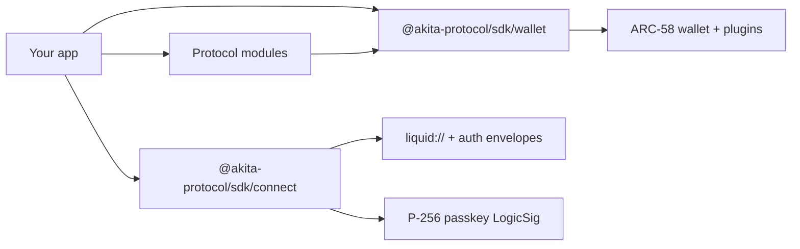

# @akita-protocol/sdk

TypeScript SDK for the Akita protocol on Algorand. A thin typed layer over on-chain apps. Import a subpath; the root export is a barrel.

## Architecture



## You want to…

| You want to… | Use |
| --- | --- |
| Create or drive an ARC-58 wallet | [`@akita-protocol/sdk/wallet`](./src/wallet/README.md) |
| Pair a dApp to Hyperspace over QR / WebRTC | [`@akita-protocol/sdk/connect`](./src/connect/README.md) |
| Plug Akita into TxnLab use-wallet v5 | [`@akta/use-wallet-akita`](../../../akita-use-wallet/README.md) |
| Call a protocol app directly | `@akita-protocol/sdk/<module>` |

## Install

```bash
pnpm add @akita-protocol/sdk
pnpm add algosdk @algorandfoundation/algokit-utils
```

**Peers:** `algosdk` ^3.7.0, `@algorandfoundation/algokit-utils` ^9.2.2

Local SDK 1.5.0 is unpublished.
It adds passkey helpers and /guild; the ARC-59 inbox methods live on RewardsPluginSDK.
Connect v3 and the use-wallet adapter are unpublished; this repo file-links the local SDK.

## Quick start

```ts
import { AlgorandClient } from '@algorandfoundation/algokit-utils'
import { newWallet, PayPluginSDK, CallerType } from '@akita-protocol/sdk/wallet'

const algorand = AlgorandClient.fromEnvironment()
const wallet = await newWallet({
  algorand,
  factoryParams: { appId: WALLET_FACTORY_APP_ID, defaultSender: me, defaultSigner: signer },
  sender: me,
  signer,
  nickname: 'my_wallet',
})

const pay = new PayPluginSDK({ factoryParams: { appId: PAY_PLUGIN_APP_ID }, algorand })
await wallet.addPlugin({ client: pay, callerType: CallerType.Global })
await wallet.usePlugin({
  callerType: CallerType.Global,
  consolidateFees: true,
  calls: [pay.pay({ payments: [{ receiver, amount: 1_000_000n, asset: 0n }] })],
})
```

## Modules

| Subpath | Exports |
| --- | --- |
| `/wallet` | WalletSDK, WalletFactorySDK, newWallet, plugin SDKs |
| `/connect` | URI, HMAC envelopes, P-256 LogicSig, Connect v2 + v3 types |
| `/social` | SocialSDK |
| `/subscriptions` | SubscriptionsSDK |
| `/rewards` | RewardsSDK |
| `/staking` | StakingSDK |
| `/staking-pool` | StakingPoolSDK, StakingPoolFactorySDK |
| `/auction` | AuctionSDK, AuctionFactorySDK |
| `/dao` | AkitaDaoSDK |
| `/marketplace` | MarketplaceSDK, ListingSDK |
| `/escrow` | EscrowSDK, EscrowFactorySDK |
| `/poll` | PollSDK, PollFactorySDK |
| `/raffle` | RaffleSDK, RaffleFactorySDK |
| `/prize-box` | PrizeBoxSDK, PrizeBoxFactorySDK |
| `/gates` | GateSDK |
| `/hyper-swap` | HyperSwapSDK |
| `/meta-merkles` | MetaMerklesSDK |
| `/guild` | GuildSDK, GuildFactorySDK, consensus helpers (new in 1.5, uncommitted) |
| `/types` | shared types |

## App IDs and constructors

App IDs resolve in this order: constructor arg, then env var, then `getNetworkAppIds()` for mainnet / testnet / localnet.

```ts
new SomeSDK({ algorand, factoryParams: { appId }, readerAccount })
```

## License

ISC
