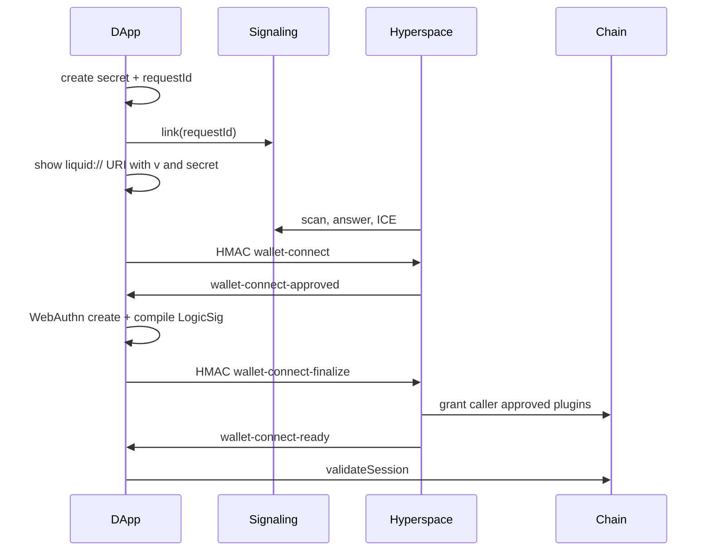

# @akta/sdk/connect

Wire format for pairing two peers over a `liquid://` URI, then an authenticated WebRTC data channel.

Two families:

- **v1/v2 agent-install** — owner grants an agent address plugins + escrow allowances
- **v3 wallet-connect** — dApp pairs to Hyperspace, signs as a P-256 passkey LogicSig


## Sequence



Signaling only sees `requestId`. The HMAC secret stays in the QR.

## URI

`liquid://signal.akita.community?requestId=<uuid>&v=3&secret=<base64url>`

`origin` is the host only (`signal.akita.community`), not an `https://` URL.

```ts
import { encodeConnectUri, decodeConnectUri, createConnectSecret } from '@akta/sdk/connect'
const secret = createConnectSecret()
const uri = encodeConnectUri({ origin: 'signal.akita.community', requestId, v: 3, secret })
```

v3 requires `secret`. Legacy agent-install may omit `v` and `secret`.

## Authenticated envelopes

`authenticateConnectMessage`, `verifyConnectMessage`, `createNonceTracker`.

`mac` is HMAC-SHA256 over the canonical envelope (sorted keys) using the URI secret. Verify rejects a bad MAC, a foreign `requestId`, an expired stamp, or a reused nonce.

## wallet-connect v3 messages

| Type | Direction |
| --- | --- |
| `wallet-connect` | dApp → wallet |
| `wallet-connect-approved` | wallet → dApp |
| `wallet-connect-finalize` | dApp → wallet (passkey id, P-256 coords, LogicSig caller) |
| `wallet-connect-ready` | wallet → dApp (`WalletConnectSession`) |
| `wallet-connect-revoke` / `-revoked` | teardown |
| `error` | either |

`WalletConnectSession`: `account`, `credential` (incl. caller), `plugins`, preview policy, optional `nativePreview` `{ endpoint, token }`, expiry.

`transactionPreview`: `never` | `optional` | `required`. `required` means the dApp must publish the unsigned group before the passkey prompt.

## Passkey LogicSig

- `extractP256PublicKeyCoordinates`
- `compileP256PasskeyLogicSig`
- `getP256PasskeyCaller`
- `getPasskeyTransactionChallenge`
- `signTransactionsWithP256Passkey`

The challenge is the txid (single) or group id (atomic), base64url. The LogicSig uses `ecdsa_verify` secp256r1.

## agent-install v1/v2

v2 moves allowances to the request root. Plugins are `{ id, methods?: { name, cooldown }[] }`.

```ts
const request = {
  type: 'agent-install',
  walletAppId,
  plugins: [{ id: PAY_PLUGIN_APP_ID, methods: [{ name: 'pay', cooldown: 0n }] }],
  allowances: [{ escrow, asset: 0n, type: 'flat', amount: 1_000_000n }],
}
```

Success: `{ type: 'agent-install', walletAppId, escrowAddress, network }`.

## Exports

**URI:** `encodeConnectUri`, `decodeConnectUri`

**Auth:** `createConnectSecret`, `createConnectNonce`, `createNonceTracker`, `authenticateConnectMessage`, `verifyConnectMessage`, `validateConnectPayload`, `validateWalletConnectRequest`, `validateWalletConnectFinalizeRequest`, `validateWalletConnectSession`

**Passkey:** `extractP256PublicKeyCoordinates`, `getP256PasskeyTeal`, `compileP256PasskeyLogicSig`, `getP256PasskeyCaller`, `parseP256DerSignature`, `createP256PasskeyLogicSigArgs`, `getPasskeyTransactionChallenge`, `signTransactionsWithP256Passkey`

Browser WebRTC / WebAuthn / session store / use-wallet adapter live in `@akta/use-wallet-akita`, not here. See [`@akta/use-wallet-akita`](../../../../../akita-use-wallet/README.md).

v3 is local-only / unpublished.
