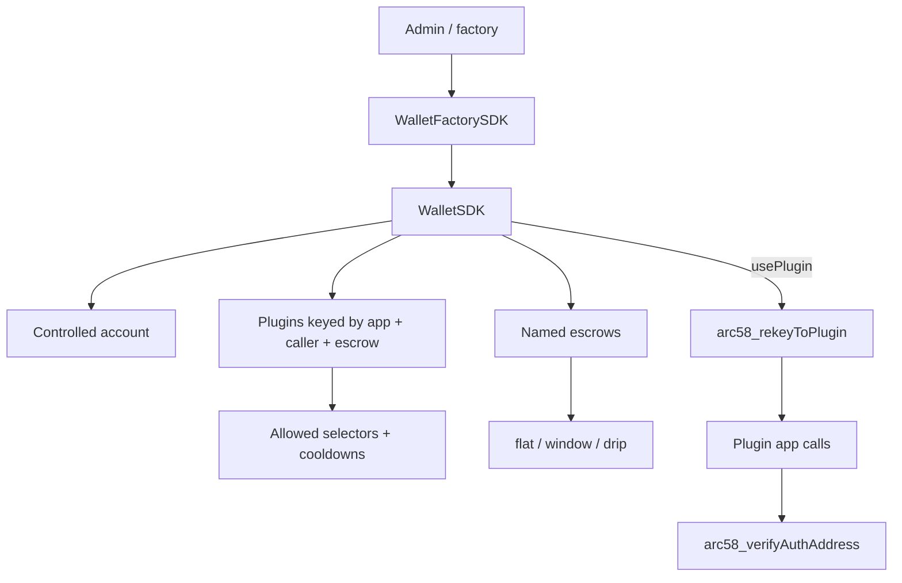

# @akta/sdk/wallet

ARC-58 abstracted accounts. A wallet app owns a controlled address, then temporarily rekeys that address to a plugin for one atomic group.

## Flow



`newWallet` creates the app and returns `WalletSDK`. Then call `addPlugin` and `usePlugin`. Whether it also writes
the EscrowFactory reverse registry depends on the network (`REGISTRY_WRITES_STOPPED` in `networks.ts`): writes
continue on TestNet/MainNet until the principal-resolution Phase 3 proposal has executed there (deployed consumers
still read the registry), and stop by default on LocalNet. Pass `register: true | false` (and
`registerEscrow: true | false` to `addPlugin`) to force either behaviour.

## Import

```ts
import { newWallet, WalletSDK, WalletFactorySDK, PayPluginSDK, CallerType } from '@akta/sdk/wallet'
```

`CallerType` is `{ Other: 0n, Global: 1n, Admin: 2n }`.

## Create

```ts
const wallet = await newWallet({
  algorand,
  factoryParams: { appId: WALLET_FACTORY_APP_ID, defaultSender: me, defaultSigner: signer },
  sender: me,
  signer,
  nickname: 'my_wallet',
})
```

Alternative: `new WalletFactorySDK(...).new(...)` (identical, never registers). Load existing: `factory.get({ appId })`.

The `referrer` you pass at creation is paid its cut of the DAO creation fee (Q1-A2); the payer pays exactly
`factory.cost()`, whoever the payer is.

## Plugins

A grant is `{ plugin, caller, escrow }`.

| `addPlugin` field | Meaning |
| --- | --- |
| `client` | Plugin SDK instance |
| `caller` / `callerType` | `Global` (1n) = zero address; `Admin` (2n) = wallet app address; `Other` (0n) = explicit caller |
| `methods` | Selector allowlist + cooldown |
| `escrow` | Required for allowances |
| `coverFees` | Plugin may cover fees |
| `useRounds` | Round-window grant |
| `useExecutionKey` | Execution-key window |
| `name` | Named plugin |

Per-plugin `allowances` on `addPlugin` is deprecated. Prefer `addAllowances` or `group().addAllowances`. Allowances are keyed `{ escrow, asset }`.

```ts
await wallet.addPlugin({ client: pay, callerType: CallerType.Global })
await wallet.usePlugin({
  callerType: CallerType.Global,
  consolidateFees: true,
  calls: [pay.pay({ payments: [{ receiver, amount: 1_000_000n, asset: 0n }] })],
})
```

`usePlugin` builds `arc58_rekeyToPlugin` + plugin calls + `arc58_verifyAuthAddress`. Consecutive calls to the same app stay in one segment.

Cost preview and execution-key windows use `wallet.build.usePlugin`, which returns `{ expectedCost, windows, send, ... }`. There is no `wallet.prepare.usePlugin`.

## Escrows

Isolated spend pools. Allowances are keyed `{ escrow, asset }`. Types: `flat`, `window`, `drip`.

Methods: `newEscrow`, `toggleEscrowLock`, `group().optInEscrow(...)`, `reclaimFunds`, `addAllowances`, `removeAllowances`.

There is no `wallet.optInEscrow` or `wallet.balance`. Opt-in is `wallet.group().optInEscrow(...)`.

### Deleting an escrow

`deleteEscrow({ escrow })` removes every plugin and allowance that names the escrow, closes its assets out to the wallet and deletes it, in one group. `getEscrowTeardown(escrow)` returns the plan it works from: what will be removed, `blockers` that no call can undo, and `warnings`.

**An app must show the plan's `warnings` prominently before the person confirms.** They say what becomes of the escrow's address, which cannot be undone and differs with the kind of escrow:

| `code` | The escrow is | After the delete |
|---|---|---|
| `address-under-nobodys-control` | the account of an app the escrow factory made | Nobody controls the address. Anything sent to it is lost. |
| `address-returns-to-its-key` | an ordinary account rekeyed to the wallet (`newEscrow` with an address) | The account is closed, which ends its rekey. The address belongs to whoever holds its private key, and no longer to the wallet. |

Each warning has a `message` ready to show and a `code` to key your own wording on. Put them in the confirmation itself, not behind a link or a tooltip. `deleteEscrow` shows and asks nothing by itself. The same goes for a delete put into a DAO or Guild proposal (`dao.deleteEscrowActions`, the guild SDK's `deleteEscrowActions`): show the warnings to the person who creates the proposal.

## Plugins shipped

PayPluginSDK, OptInPluginSDK, SelfOptInPluginSDK, AsaManagerPluginSDK, SubscriptionsPluginSDK, SocialPluginSDK, RewardsPluginSDK, StakingPluginSDK, StakingPoolPluginSDK, AuctionPluginSDK, DAOPluginSDK, MarketplacePluginSDK, HyperSwapPluginSDK, GatePluginSDK, PollPluginSDK, RafflePluginSDK, NFDPluginSDK, PaySiloPluginSDK.

## Connect / passkeys

A Hyperspace session installs a plugin grant for the P-256 LogicSig caller from [`@akta/sdk/connect`](../connect/README.md). Adapter: [`@akta/use-wallet-akita`](../../../../../akita-use-wallet/README.md).

## API

| Area | Methods |
| --- | --- |
| Lifecycle | `changeAdmin`, `changeRevocationApp`, `verifyAuthAddress`, `rekeyTo`; `register` (deprecated, legacy registry only) |
| Principal resolution | `windowHint` (the hint Akita plugins forward: this wallet's app id), `predictPrincipal` (prediction only), `principalResources`; `usePlugin({ seedPrincipalResources: true })` seeds them into the Access-list preparer |
| Co-admin passkeys | `assignDomain` (a key whose domain equals the wallet domain is a co-admin; reassigning refunds the old key's MBR), `removeDomainKey` (revokes and refunds; on-chain `assignDomain(key, '')`), `getDomainKey`. An admin change through an admin plugin (recovery) clears the wallet domain, disabling every co-admin key until the new admin calls `setDomain`. |
| Profile | `setNickname`, `setAvatar`, `setBanner`, `setBio` |
| Plugins | `addPlugin`, `usePlugin`, `removePlugin` (the admin, the revocation app, or the grant's own caller: pass that caller as `sender`), `removeNamedPlugin`, `canCall`, `getPlugins`, `getPluginByKey`, `getNamedPlugins`, `getPluginByName` |
| Escrows | `newEscrow`, `getEscrows`, `getEscrow`, `toggleEscrowLock`, `reclaimFunds`, `getEscrowTeardown`, `deleteEscrow` |
| Allowances | `addAllowances`, `removeAllowances`, `getAllowances`, `getAllowance` |
| Execution keys | `addExecutionKey`, `removeExecutionKey`, `getExecutions`, `getExecution` |
| Reads | `getGlobalState`, `getAdmin`, `getMbr` |
| Advanced | `build.usePlugin`, `group()`, `group().optInEscrow(...)`, `group().addAllowances` |

`getMbr` talks to the wallet MBR app so you can fund boxes before `addPlugin`.

`addExecutionKey` and `group().addExecutionKey(...)` accept `lease`, `groups`,
`firstValid`, and `lastValid`. Existing keys can append group hashes only with
matching validity rounds. Successful execution consumes the key; the admin can
remove it at any time, and anyone can remove it after expiry.

Review transaction contents and recompute the proposed group IDs off-chain
before authorizing them. The wallet checks the executing group ID against those
approved hashes and enforces the validity rounds.
